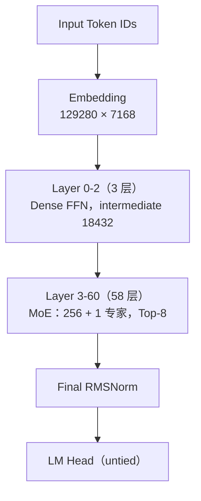
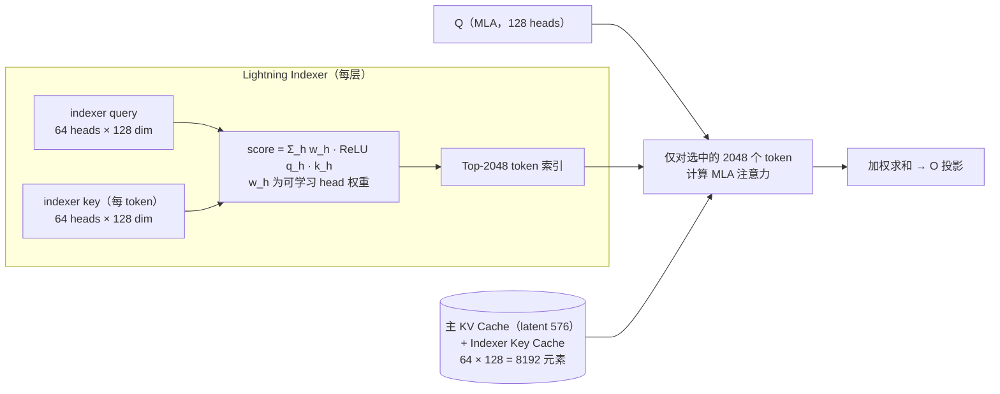

# DeepSeek-V3.2

`DeepSeek-V3.2 系列 · MoE · MLA + DSA · 671B 总参数 / 37B 激活 · 2025-12 发布`

DSA（DeepSeek Sparse Attention）的首个正式版：在 [DeepSeek-V3](/deepseek/deepseek-v3/) 的 MLA + MoE 骨架上，给每层加装一个轻量 lightning indexer，为每个 query 只选 top-2048 个历史 token 参与注意力，长上下文的注意力计算量与访存从 O(S) 降到 O(2048)。训练侧配套大规模 RL（Speciale 变体在 IMO/IOI 2025 拿金牌）与 agentic 任务合成管线（模型卡）。

## 规格总览

以下数值除注明外均取自 [HF config.json](https://huggingface.co/deepseek-ai/DeepSeek-V3.2/raw/main/config.json)（本地快照 `data/models/raw/deepseek-v3.2.json`）。

| 项 | 值 |
| --- | --- |
| 模型类 | `DeepseekV32ForCausalLM`（`model_type: deepseek_v32`） |
| 总参数 / 激活参数 | 671B / 37B（模型卡基线表，同 V3） |
| 层数 | 61（`first_k_dense_replace = 3`：前 3 层 Dense，后 58 层 MoE） |
| Hidden Size | 7168 |
| Attention | MLA：`q_lora_rank 1536`，`kv_lora_rank 512`，`qk_nope_head_dim 128`，`qk_rope_head_dim 64`，`v_head_dim 128`，Q Heads 128 |
| **DSA Indexer** | `index_topk 2048`，`index_n_heads 64`，`index_head_dim 128`（每层一个） |
| RoPE | 仅 64 维 rope 分量；`theta = 1e4`，YaRN ×40（4096 → 163840） |
| Dense FFN | intermediate 18432（仅前 3 层） |
| MoE | 256 路由专家 + 1 共享专家，Top-8，`moe_intermediate_size = 2048` |
| Router | sigmoid 打分 + `e_score_correction_bias` + 组内筛选（`n_group 8`、`topk_group 4`）+ `noaux_tc`；`routed_scaling_factor = 2.5` |
| MTP | `num_nextn_predict_layers = 1` |
| 权重精度 / 体积 | 原生 **FP8**（blockwise 128×128，`scale_fmt: ue8m0`——比 V3 新增的指数缩放格式）· **689.5 GB**（仓库 safetensors 实测总和，`data/models/weight_sizes.json`，下同） |
| KV Cache 精度 | 主 latent 默认 **BF16**（576 元素 → 68.6 KiB/token）+ indexer key 官方实现 **FP8**（≈488 KiB/token），合计 ≈557 KiB/token（推算，见 Attention 节） |
| 上下文 | 163840（160K） |

与 V3 的 config diff 仅四类：新增 `index_*` 三字段、`model_type` 换代、FP8 缩放格式改 `ue8m0`、MTP 保留 1 层——**注意力主体（MLA 维度、576 元素 latent cache）一个字未动**，DSA 是纯增量改装。

## 整体结构

层内布局与 V3 一致（Pre-Norm 残差），差异集中在 Attention 内部新增的 indexer 支路与 indexer cache。

## Attention：MLA + DSA（稀疏化）

MLA 计算图与 [DeepSeek-V3 页](/deepseek/deepseek-v3/) 完全相同（KV Cache 仍是 576 元素/token/层的 latent + rope）。DSA 改变的是**注意力作用的对象**：

推理工程师关心的三个数：

- **Indexer Key Cache 才是 KV 大头**：每 token 每层 `64 × 128 = 8192` 元素，是 MLA latent（576）的 14 倍。DeepSeek 官方实现将 indexer key 以 FP8 存储；主 latent 可 BF16/FP8。每 token 合计（61 层）：主 cache `576 × 2B × 61 ≈ 68.6 KiB`（BF16）+ indexer `8192 × 1B × 61 ≈ 488 KiB`（FP8）≈ **557 KiB/token**（推算值；vLLM/SGLang 实现口径）。
- **解码注意力代价与序列长度解耦**：每个 query 只对 top-2048 token 做 MLA 注意力 + 一个可学习 sink token，长上下文下注意力 FLOPs 与 KV 读取代价从 O(S) 封顶到 O(2048)（模型卡：为长场景优化、大幅降低计算复杂度）。
- indexer 是轻量算子（单层 MLP 量级、ReLU 打分、无需 softmax），打分本身 O(S·64·128)，但可在压缩域/分块域做（V4 系列进一步演化，见 [DeepSeek-V4](/deepseek/deepseek-v4/)）。

## MoE：与 V3 完全同款

路由公式、专家结构、激活参数估算见 [DeepSeek-V3 页](/deepseek/deepseek-v3/)——256+1 专家、Top-8、sigmoid + `noaux_tc`、组内筛选（8 组选 4）、scaling 2.5，全部未变。

## 演进

| 模型 | 时间 | 架构变化 |
| --- | --- | --- |
| DeepSeek-V3.2-Exp | 2025-09 | **DSA 首秀**（实验版，API 价格同步大幅下调） |
| DeepSeek-V3.2-Speciale | 2025-11 | 高算力 RL 变体：IMO/IOI 2025 金牌水平（模型卡），不做工具调用 |
| DeepSeek-V3.2 | 2025-12 | DSA 正式版；chat template 重做（thinking-with-tools、`developer` 角色、Python 编码器替代 Jinja） |
| DeepSeek-V4 系列 | 2026-04 | CSA + HCA 混合注意力、mHC、FP4 专家（见 [DeepSeek-V4](/deepseek/deepseek-v4/)） |

## 部署备注

- 本地运行与权重结构同 V3.2-Exp，官方指引在 [DeepSeek-V3.2-Exp GitHub 仓库](https://github.com/deepseek-ai/DeepSeek-V3.2-Exp)。
- 推荐采样：`temperature = 1.0, top_p = 0.95`（模型卡）。
- 无 Jinja chat template：需用官方 `encoding/` 目录的 Python 编解码器（`encode_messages` / `parse_message_from_completion_text`）。

## 原始资料

- [Hugging Face 模型仓库](https://huggingface.co/deepseek-ai/DeepSeek-V3.2)（模型卡 / config.json）
- [技术报告（仓库内 assets/paper.pdf）](https://huggingface.co/deepseek-ai/DeepSeek-V3.2/blob/main/assets/paper.pdf)
- [DeepSeek-V3.2-Exp GitHub 仓库](https://github.com/deepseek-ai/DeepSeek-V3.2-Exp)（本地运行指南）
- 本地 config 快照：`data/models/raw/deepseek-v3.2.json`
