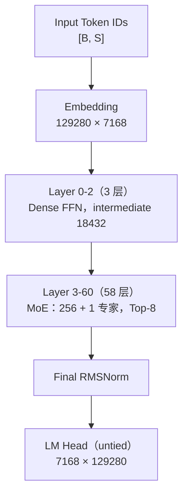
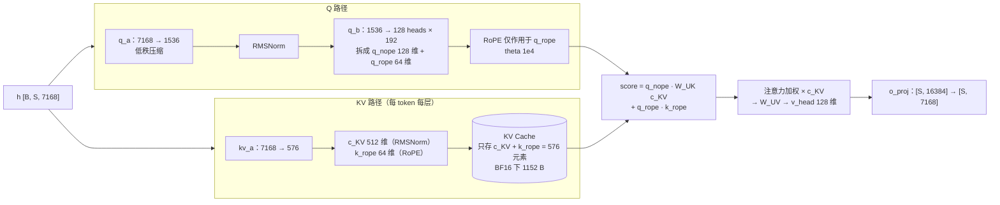
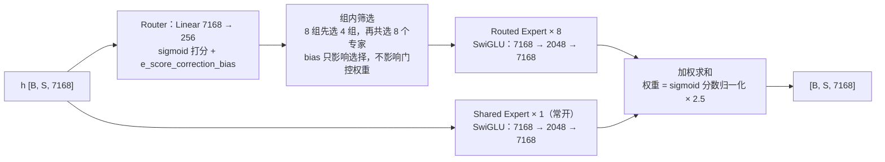

# DeepSeek-V3

`DeepSeek-V3 系列 · MoE · MLA · 671B 总参数 / 37B 激活 · 2024-12 发布`

MLA（Multi-head Latent Attention）与无辅助损失负载均衡 MoE 的集大成者：61 层、前 3 层 Dense FFN + 58 层细粒度 MoE（256 选 8 + 1 共享专家）、每 token 每层 KV Cache 仅 576 个元素，并以 FP8 混合精度训练（14.8T tokens，模型卡）。

## 规格总览

以下数值除注明外均取自 [HF config.json](https://huggingface.co/deepseek-ai/DeepSeek-V3/raw/main/config.json)（本地快照 `data/models/raw/deepseek-v3.json`）。

| 项 | 值 |
| --- | --- |
| 模型类 | `DeepseekV3ForCausalLM`（`model_type: deepseek_v3`，远程代码） |
| 总参数 / 激活参数 | 671B / 37B（模型卡） |
| 层数 | 61（`first_k_dense_replace = 3`：前 3 层 Dense，后 58 层 MoE） |
| Hidden Size | 7168 |
| Attention | MLA：`q_lora_rank 1536`，`kv_lora_rank 512`，`qk_nope_head_dim 128`，`qk_rope_head_dim 64`，`v_head_dim 128`，Q Heads 128 |
| RoPE | 仅作用在每 head 的 64 个 rope 维；`theta = 1e4`，YaRN ×40（4096 → 163840） |
| Dense FFN | intermediate 18432（仅前 3 层） |
| MoE | 256 路由专家 + 1 共享专家，Top-8，`moe_intermediate_size = 2048` |
| Router | sigmoid 打分 + `e_score_correction_bias` + 组内筛选（`n_group 8`、`topk_group 4`）+ `noaux_tc`；`routed_scaling_factor = 2.5` |
| MTP | `num_nextn_predict_layers = 1`（多 token 预测，投机解码用） |
| 权重精度 / 体积 | 主仓原生 **FP8**（blockwise 128×128，训练即 FP8）· **688.6 GB**（safetensors 实测总和，`data/models/weight_sizes.json`，下同；折合 BF16 约 1.34 TB 量级，推算） |
| KV Cache 精度 | 默认 **BF16**（latent 576 元素/token/层 → 68.6 KiB/token，见 Attention 节）；官方无量化 KV 配置，FP8 latent KV 属框架侧能力 |
| 词表 | 129280，untied |

## 整体结构

每个 DecoderLayer 均为 Pre-Norm 残差结构（RMSNorm → Attention → 残差相加 → RMSNorm → FFN/MoE → 残差相加），与 [Qwen3-30B-A3B](/qwen/qwen3-30b-a3b/) 的层内布局一致，差异全部在 Attention 与 FFN 内部。

## Attention：MLA（Multi-head Latent Attention）

要点：

- **KV Cache（BF16）**：每 token 每层 `576 × 2B = 1152 B`，61 层合计 **≈ 68.6 KiB/token**。对比同样 128 个 Q head 的 MHA（128×(128+128)=32768 元素/层），压缩约 57 倍；对比 GQA 8 KV head（2048 元素/层）也省 3.5 倍以上。
- **权重吸收（absorption）**：解码时 `W_UK` 可并入 Q 侧、`W_UV` 可并入 O 侧，注意力直接在 576 维 latent 空间计算，无需先还原成完整 K/V——这是 MLA 推理高效的关键，也是各推理框架实现差异最大的地方。
- 位置编码只施加在 64 维 rope 分量上，保证 c_KV 是纯 latent、可跨 token 复用压缩表示。

## MoE：细粒度专家 + 无辅助损失负载均衡

要点：

- **无辅助损失负载均衡**（auxiliary-loss-free）：用每专家一个可学习 bias 修正选择概率，代替会损害质量的 auxiliary loss；`noaux_tc` 中 bias 只进入 TopK 选择、不进入门控值。
- 每 token 实际经过 8 个路由专家 + 1 个共享专家（intermediate 都是 2048）。
- **激活参数估算**：MoE ≈ 58 × (8+1) × 3 × 7168×2048 + 3 层 Dense 1.19B ≈ 24.3B；Attention ≈ 61 × 187M ≈ 11.4B；Embedding + Head ≈ 1.85B；合计 ≈ **37.5B**，与官方 37B 一致。
- FP8 训练：权重按 128×128 block 做 FP8 缩放，是当时最大规模的 FP8 训练实践。

## 演进

| 模型 | 时间 | 架构变化 |
| --- | --- | --- |
| DeepSeek-V2 | 2024-05 | **首发 MLA**（KV 低秩压缩）+ 轻量 MoE（236B A21B） |
| DeepSeek-V3 | 2024-12 | 671B A37B；细粒度专家加倍（256）；无辅助损失负载均衡；MTP；FP8 训练 |
| DeepSeek-V3.1 | 2025-08 | 权重小幅更新，架构不变，长文本增强 |
| DeepSeek-V3.2-Exp | 2025-09 | **DSA 稀疏注意力**（lightning indexer + top-k token 选择），推理成本大幅下降 |
| DeepSeek-V3.2 | 2025-12 | DSA 正式版 |
| DeepSeek-V4 系列 | 2026-04 | V4-Pro / V4-Flash（2026-04），V4.1-Flash（2026-09/10） |

## 原始资料

- [Hugging Face 模型仓库](https://huggingface.co/deepseek-ai/DeepSeek-V3)（config.json / 模型卡）
- [DeepSeek-V3 技术报告（arXiv:2412.19437）](https://arxiv.org/abs/2412.19437)
- 本地 config 快照：`data/models/raw/deepseek-v3.json`
