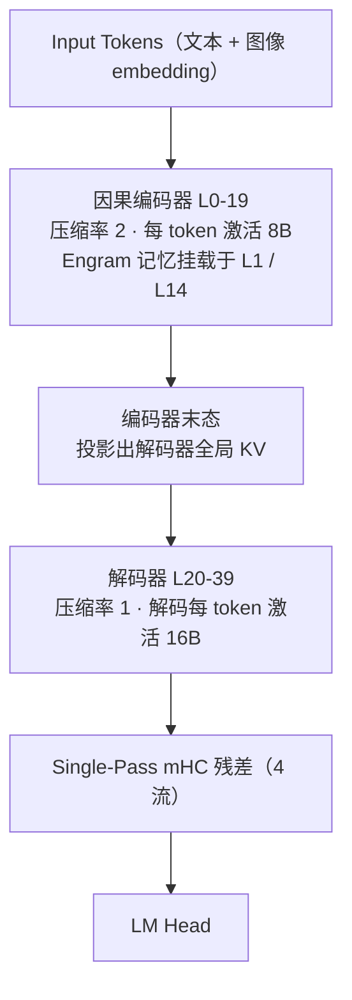
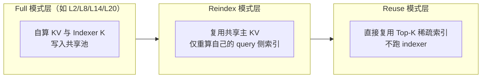

# DeepSeek-V4.1-Flash

`DeepSeek-V4.1 系列 · MoE · CED 编码器-解码器 · CSA2 · 552B backbone（含 196B Engram 记忆）· 原生多模态 · 1M 上下文 · 2026-09 发布`

把 KV Cache 压缩推到当前极限的一代：**Causal Encoder-Decoder（CED）** 把 40 层切成 20 层因果编码器 + 20 层解码器，解码器的全局 KV 由编码器末态投影而来（不再逐解码层自算）；**CSA2** 让各注意力层以 Full / Reindex / Reuse 三种静态模式跨层共享 KV 与索引；主 KV 直接以 **FP4（E2M1）** 存储。官方口径：全局 KV **890 B/token**，约为 [V4-Flash](/deepseek/deepseek-v4/) 的 1/4、V1 的 1/437；预填每 token 仅激活 **8B** 参数、解码 16B（模型卡）。另内置 **Engram 条件记忆（196B）** 与 **DSpark 投机解码**。45T 多模态 token 从头训练。

## 规格总览

以下数值除注明外均取自 [HF config.json](https://huggingface.co/deepseek-ai/DeepSeek-V4.1-Flash/raw/main/config.json) 的 `text_config`（本地快照 `data/models/raw/deepseek-v4.1-flash.json`）。

| 项 | 值 |
| --- | --- |
| 模型类 | `DeepseekV41ForCausalLM`（`deepseek_v41_text`，外层多模态包装） |
| Backbone 参数 | **552B**（模型卡；其中 Engram 记忆 196B） |
| 激活参数 | **8B（prefill）/ 16B（decode）**（模型卡，CED 口径） |
| 层数 | 40 = **20 层因果编码器 + 20 层解码器** |
| Hidden Size | 5120 |
| Q Heads × head_dim | 64 × 512（`q_lora_rank 1280`） |
| KV | 单一 512 维共享流（`num_key_value_heads = 1`），rope 64/512，同 V4 |
| O 投影 | 分组低秩：`o_groups 8`，`o_lora_rank 1024` |
| 压缩率 | 编码器层 2、解码器层 1（`compress_ratios`：L2-19 = 2，L20-39 = 1；`compress_rope_theta 160000`） |
| **CSA2 跨层共享** | `kv_source_layer_ids [2,8,14,20]`、`index_source_layer_ids [2,8,14,20,24,28,32,36]`、候选池源层 20（`candidate_topk_blocks 2048 × block_size 8`） |
| Indexer | `index_topk 512`，32 heads × 128 dim |
| `sliding_window` | 128 |
| MoE | 384 路由 + 1 共享，Top-6，`moe_intermediate_size 2304`，`sqrtsoftplus` + `noaux_tc`，scaling 1.5（同 [V4](/deepseek/deepseek-v4/)） |
| 残差 | **Single-Pass mHC**（`hc_mult 4`，官方 Mega-mHC kernel） |
| **Engram 记忆** | 196B（模型卡）；2 张约 3.84 亿行的嵌入表（`engram_num_embeddings [384006168, 384016682]`），4-gram token 查找（`engram_vocab_size 16000000`，压缩词表 99092），8 heads × 256 dim，挂载层 [1, 14] |
| **DSpark 投机解码** | `num_nextn_predict_layers 3`：3 个 draft 层（L37-39），半自回归块生成（block 5）+ 置信度调度验证；draft 自带 128 专家 Top-3 MoE 头（`dspark_*` 字段组） |
| RMSNorm eps | `1e-20`（远小于常规 1e-6，配合 FP4/FP8 的动态范围） |
| 上下文 | 1,048,576（YaRN ×16） |
| 多模态 | DeepSeek-ViT（2D-RoPE + 3×3 pixel-unshuffle）+ 两层 MLP projector，预训练即图文混训 |
| 权重精度 / 体积 | 原生 **FP4+FP8 混合**（同 [V4](/deepseek/deepseek-v4/)：MoE 专家 FP4，其余 FP8；Engram 嵌入表 FP8）· **510.3 GB**（[1017 刷新版](https://huggingface.co/deepseek-ai/DeepSeek-V4.1-Flash-1017) 同为 510.3）。体积为仓库 safetensors 实测总和（`data/models/weight_sizes.json`，下同） |
| KV Cache 精度 | 主 KV 原生 **FP4（E2M1）**：全局 KV **890 B/token**（模型卡口径，含 CED/CSA2 共享后的全部全局流；本地窗口有界另计，见 Attention 节） |

## 整体结构：Causal Encoder-Decoder

关键换型：常规 Transformer 每层各自维护 KV，CED 里**解码层的全局 KV 是从编码器最终隐状态一次性投影出来的**——输入侧只算一遍编码器（激活 8B），解码侧不再为每层重算全局 KV（模型卡 §Architecture）。这直接瞄准输入远长于输出的 agentic 负载。

## Attention：CSA2（跨层共享 + 分层索引）

在 [V4 的 CSA/HCA](/deepseek/deepseek-v4/) 基础上，每层被指派三种**静态模式**之一：

- 共享源由 config 精确点名：主 KV 来自 `kv_source_layer_ids [2,8,14,20]`，indexer K 来自 8 个 `index_source_layer_ids`；其余层按模式取用（模型卡 §CSA2；config 字段一一对应）。
- **分层稀疏索引**（Hierarchical Sparse Indexer）：后续索引层的候选池先被第一个 Full 层限制在 `2048 个 block × 8 token` 内，再在其中选 top-512——深层的索引代价与上下文长度解耦。
- **FP4 主 KV**：E2M1 格式、每 16 通道一个 E4M3 缩放（模型卡），全局 KV 合计 **890 B/token**。
- **SWA Bounded Replay**：SWA-128 的 KV 不落盘持久化，需要时只重放最近一个窗口的 token 重建状态——持久化 KV 足迹约为 V4-Flash 的 1/8（模型卡）。

## Engram 条件记忆与 DSpark

- **Engram**（挂载 L1/L14）：按 token 4-gram 从两张约 3.84 亿行的嵌入表中稀疏查找（词表 1600 万、压缩到 99092 后进 8×256 的头），把「记忆」从注意力里拆出来放进可稀疏寻址的外部参数——196B 参数按需激活，不占常规 FLOPs（模型卡：token-based lookup、sparsely accessed）。
- **DSpark 投机解码**（内置，draft 层 L37-39）：半自回归地一次生成 5-token 块，验证按置信度调度；draft 头是一个独立小 MoE（128 专家 Top-3 + Markov 秩 256 结构先验）。同款 DSpark 权重也单独发布过（`dspark_qwen3_*` 系列，可给其他模型当 draft）。

## 演进

| 模型 | 时间 | 架构变化 |
| --- | --- | --- |
| DeepSeek-V4.1-Flash | 2026-09 | 本页：CED、CSA2、FP4 KV、Engram、内置 DSpark |
| DeepSeek-V4.1-Flash-1017 | 2026-10 | 训练刷新，架构不变 |

## 部署备注

- 推理力度（reasoning effort）**1-100 连续可调**，用数值换精度（模型卡）。
- 推荐采样：`temperature 1.0`，`top_p 0.95 或 1.0`；`max_tokens ≥ 256K`。
- 提示编码：无 Jinja 模板，用官方 `encoding/` 或 [deepseek-recipe](https://github.com/deepseek-ai/deepseek-recipe)（Rust + Python binding）。
- 稀疏注意力在 64K 序长下训练、34T token 处扩展到 1M（模型卡 §Pre-training）。

## 原始资料

- [Hugging Face 模型仓库](https://huggingface.co/deepseek-ai/DeepSeek-V4.1-Flash)（模型卡 / config.json）
- [deepseek-recipe（官方提示编码工具）](https://github.com/deepseek-ai/deepseek-recipe)
- 本地 config 快照：`data/models/raw/deepseek-v4.1-flash.json`
