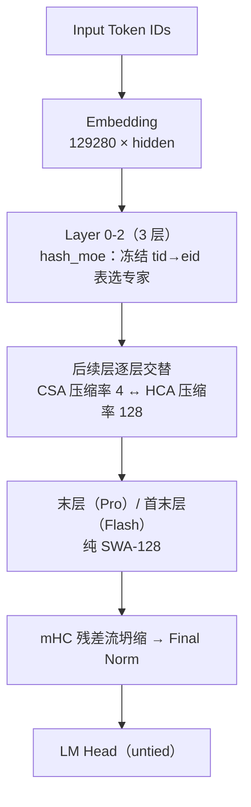
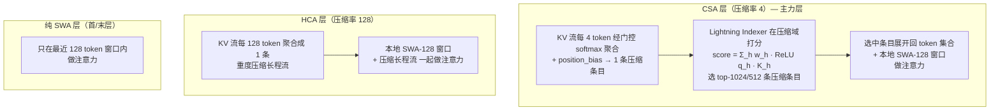
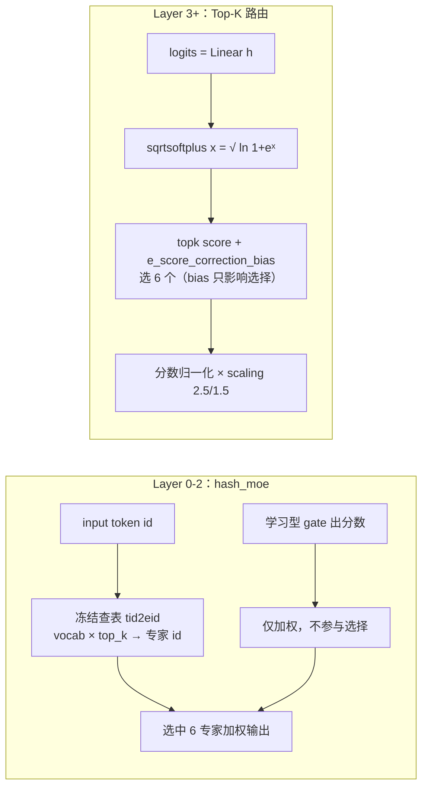

# DeepSeek-V4

`DeepSeek-V4 系列 · MoE · CSA + HCA 混合稀疏注意力 · mHC · V4-Pro 1.6T/A49B · V4-Flash 284B/A13B · 1M 上下文 · 2026-04 发布`

面向百万 token 上下文效率的重新设计：注意力层分成 **CSA（Compressed Sparse Attention）** 与 **HCA（Heavily Compressed Attention）** 两类逐层交替，KV 从 V3 的「每 head 低秩 latent」改为**单一 512 维共享 KV 流 + 分层压缩**；残差改为 **mHC（流形约束超连接）**；MoE 专家权重直接以 **FP4** 存储。官方口径：1M token 设定下 V4-Pro 的单 token 推理 FLOPs 仅为 [V3.2](/deepseek/deepseek-v3.2/) 的 **27%**、KV Cache 仅 **10%**（模型卡）。预训练 32T tokens，Muon 优化器。

## 规格总览

以下数值除注明外均取自 [V4-Pro](https://huggingface.co/deepseek-ai/DeepSeek-V4-Pro/raw/main/config.json) / [V4-Flash](https://huggingface.co/deepseek-ai/DeepSeek-V4-Flash/raw/main/config.json) 的 config.json（本地快照 `data/models/raw/deepseek-v4-pro.json`、`deepseek-v4-flash.json`）。

| 项 | V4-Pro | V4-Flash |
| --- | --- | --- |
| 模型类 | `DeepseekV4ForCausalLM`（`deepseek_v4`） | 同左 |
| 总参数 / 激活（模型卡） | **1.6T / 49B** | **284B / 13B** |
| 层数 | 61 | 43 |
| Hidden Size | 7168 | 4096 |
| Q Heads × head_dim | 128 × **512**（`q_lora_rank 1536`） | 64 × **512**（`q_lora_rank 1024`） |
| KV | **`num_key_value_heads = 1`**，单一 512 维共享流（`kv_proj: hidden → 512`），rope 占 64/512（交织排布） | 同左 |
| O 投影 | 分组低秩：`o_groups 16`，`o_lora_rank 1024` | `o_groups 8`，`o_lora_rank 1024` |
| Indexer | `index_topk 1024`，64 heads × 128 dim | `index_topk 512`，64 heads × 128 dim |
| 层类型分布（`compress_ratios`） | HCA×31 / CSA×30 / SWA×1（末层；L0-1 连续 HCA 后 CSA/HCA 交替） | CSA×21 / HCA×20 / SWA×3（首 2 层 + 末层） |
| `sliding_window` | 128 | 128 |
| MoE | **全部 61 层 MoE**（无 Dense 层）：前 3 层 `hash_moe` + 其余 Top-K；384 路由 + 1 共享，Top-6，`moe_intermediate_size 3072` | 同机制；256 路由 + 1 共享，Top-6，`moe_intermediate_size 2048` |
| Router | **`sqrtsoftplus`** 打分 + `noaux_tc`（无组内筛选）；`routed_scaling_factor 2.5` | 同左，scaling 1.5 |
| 残差 | **mHC**：`hc_mult 4` 条残差流，Sinkhorn-Knopp 20 次迭代约束混合矩阵 | 同左 |
| FFN 激活 | SiLU，`swiglu_limit 10.0`（门控/上投影钳位） | 同左 |
| 权重精度 / 体积 | 原生 **FP4+FP8 混合** · **864.7 GB**（[0813 刷新版](https://huggingface.co/deepseek-ai/DeepSeek-V4-Pro-0813) 892.7 GB） | 同格式 · **159.6 GB**（[0731 刷新版](https://huggingface.co/deepseek-ai/DeepSeek-V4-Flash-0731) 166.9 GB）。体积为仓库 safetensors 实测总和（`data/models/weight_sizes.json`，下同） |
| KV Cache 精度 | 主 KV 流默认 **BF16**（CSA ≈128 / HCA ≈4 元素/token/层，结构推算见 Attention 节；FP4 KV 到 [V4.1](/deepseek/deepseek-v4.1-flash/) 才引入） | 同左 |
| 上下文 | 1,048,576（YaRN ×16，65536 → 1M） | 同左 |
| MTP | `num_nextn_predict_layers = 1` | 同左 |

## 整体结构

每个 DecoderLayer 外面套着 mHC 的四条残差流（见下节），层内仍是 Norm → Attention → Norm → MoE。

## Attention：CSA + HCA 混合

KV 表示彻底改型：**不再有 per-head 的 latent**，而是全模型每 token 每层投影出**一条 512 维共享 KV 流**（`num_key_value_heads = 1`，transformers `modeling_deepseek_v4.py` 中 `kv_proj = Linear(hidden, 512)`），RoPE 只作用在 512 维中的 64 维（交织对排布，`partial_rotary_factor = 64/512`）。128 个 Q head（各 512 维）都对着这同一条 KV——相当于「加宽的 MQA」。O 侧因为 `128 × 512 = 65536` 维输出直接投影回 hidden 代价过高，改为**分组低秩**（`o_groups` 组分别降到 `o_lora_rank` 再混合）。

在此之上，每层按 `compress_ratios` 指定的压缩率归入三类：

要点：

- **CSA 是 DSA 的压缩域升级**：[V3.2](/deepseek/deepseek-v3.2/) 的 indexer 对原始 token 打分，V4 的 indexer 对压缩条目打分（indexer 自带一套 `index_head_dim 128` 的缩小版压缩器），选择代价再降一个压缩率倍数（transformers 源码注释：相对 full attention 的复杂度缩减为 `(S / 4) / index_topk`）。`index_topk` 同时从 2048 降到 1024（Pro）/ 512（Flash）。
- **HCA 层没有 indexer**：长程信息走「每 128 token 一条」的重度压缩流，细节由 SWA-128 本地窗口兜底——这是「全局粗、局部精」的分层设计。
- **KV Cache 量级**（结构推算，BF16）：CSA 层持续化部分 ≈ `512/4 = 128` 元素/token + indexer 压缩条目；HCA 层 ≈ `512/128 = 4` 元素/token；SWA 窗口有界不随 S 增长。官方口径：1M 上下文下 V4-Pro 总 KV 为 V3.2 的 10%（模型卡）。
- 压缩聚合是**有参数的**：`gate_proj`（512 维）出门控、`position_bias [compress_rate, 512]` 提供窗口内位置先验，softmax 加权合成压缩条目（transformers `DeepseekV4HCACache`）。

## 残差：mHC（Manifold-Constrained Hyper-Connections）

普通残差升级为 4 条并行残差流（`hc_mult 4`，与 Hunyuan Hy4 的 iHC 同属 hyper-connections 家族）：每层入口把 hidden 扩展成 4 条流，层后经「pre / comb / post」三组可学习权重坍缩回去；其中 comb（流间混合）矩阵用 **Sinkhorn-Knopp 迭代（20 次）约束到双随机邻域**，即「流形约束」，用于稳定深网络信号传播（模型卡；transformers `DeepseekV4HyperConnection`，引用 Xie et al., 2026）。

## MoE：hash_moe 前置 + sqrtsoftplus 路由 + FP4 专家

- **前 3 层 hash_moe**（论文 §2.1；transformers `DeepseekV4HashRouter`）：选哪个专家由一张**冻结的 token-id → expert-id 查找表**决定，学习型 gate 只提供权重——浅层路由静态化，训练更稳。
- **sqrtsoftplus 打分**：`score = √(softplus(x)) = √(ln(1+eˣ))`（transformers `activations.py: SqrtSoftplusActivation`，注释明确 "the router scoring function used by DeepSeek V4"）。与 sigmoid 同为饱和型，但保留幅度信息；V3 的组内筛选（`n_group`）被移除，bias + `noaux_tc` 保留。
- **FP4 专家**：`expert_dtype: fp4`，模型卡明确「MoE expert 参数 FP4，其余 FP8」——总参数 1.6T 的权重体积主要靠 FP4 压住。
- `swiglu_limit 10.0`：SwiGLU 的 gate/up 做幅值钳位（transformers 实现中 gate 上钳、up 双向钳），大激活防护。

## 演进

| 模型 | 时间 | 架构变化 |
| --- | --- | --- |
| DeepSeek-V4-Pro / V4-Flash（+Base） | 2026-04 | 本页：CSA+HCA、mHC、hash_moe、sqrtsoftplus、FP4 专家、1M ctx |
| V4-Flash-DSpark / V4-Pro-DSpark | 2026-06 | 配套 DSpark 投机解码权重（后续成为 V4.1 内置组件） |
| DeepSeek-V4-Flash-0731 / V4-Pro-0813 | 2026-07/08 | 训练迭代刷新，架构不变 |
| DeepSeek-V4.1-Flash | 2026-09 | CED 编码器-解码器 + CSA2 + FP4 KV cache（见 [V4.1 页](/deepseek/deepseek-v4.1-flash/)） |

## 部署备注

- Think Max 模式建议上下文 ≥ 384K（模型卡）。
- 推荐采样：`temperature = 1.0, top_p = 1.0`。
- 三档推理模式：Non-think / Think High / Think Max（Max 对应 V4-Pro-Max / V4-Flash-Max 口径）。
- 无 Jinja chat template，用官方 `encoding/` Python 编解码器；本地运行见仓库 `inference/` 目录（含权重转换）。

## 原始资料

- [V4-Pro 模型仓库](https://huggingface.co/deepseek-ai/DeepSeek-V4-Pro) · [V4-Flash 模型仓库](https://huggingface.co/deepseek-ai/DeepSeek-V4-Flash)（模型卡 / config.json）
- [技术报告 arXiv:2606.19348](https://arxiv.org/abs/2606.19348)
- transformers 实现：[`models/deepseek_v4/`](https://github.com/huggingface/transformers/tree/main/src/transformers/models/deepseek_v4)（`modeling_deepseek_v4.py` 的 CSA/HCA/mHC/Router 实现）
- 本地 config 快照：`data/models/raw/deepseek-v4-pro.json`、`deepseek-v4-flash.json`
