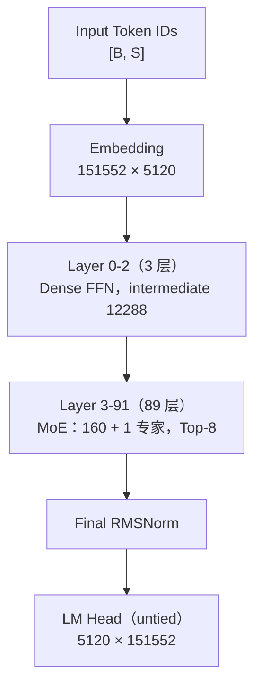
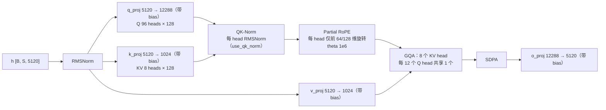
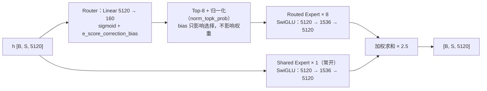

# GLM-4.5

`GLM-4.5 系列 · MoE · GQA（Partial RoPE）· 357B 总参数 / 32B 激活 · 2025-07 发布`

智谱面向 agentic 场景的大比例 MoE：92 层、160+1 专家、前 3 层 Dense。注意力保留 GQA（96 Q / 8 KV head），但有三处少见的坚持：**半维 RoPE**（`partial_rotary_factor 0.5`）、**保留 QKV/O bias**（`attention_bias true`）、**QK-Norm**。同日发布轻量版 GLM-4.5-Air（106B / 12B 激活，模型卡）。

## 规格总览

以下数值除注明外均取自 [HF config.json](https://huggingface.co/zai-org/GLM-4.5/raw/main/config.json)（本地快照 `data/models/raw/glm-4.5.json`）。

| 项 | 值 |
| --- | --- |
| 模型类 | `Glm4MoeForCausalLM`（`model_type: glm4_moe`） |
| 总参数 / 激活参数 | 357B / 32B（模型卡）；Air 版 106B / 12B |
| 层数 | 92（`first_k_dense_replace = 3`：前 3 层 Dense，后 89 层 MoE） |
| Hidden Size | 5120 |
| Attention | GQA：Q Heads 96，KV Heads 8，Head Dim 128 |
| RoPE | `partial_rotary_factor = 0.5`：每 head 仅 64/128 维旋转；`theta = 1e6`；无 rope_scaling，原生 131072 |
| QKV Bias | **有**（`attention_bias: true`，q/k/v/o 投影均带 bias——2025 年旗舰模型中的少数派） |
| QK-Norm | `use_qk_norm: true`（每 head RMSNorm） |
| Dense FFN | intermediate 12288（仅前 3 层） |
| MoE | 160 路由专家 + 1 共享专家，Top-8，`moe_intermediate_size = 1536` |
| Router | sigmoid + `e_score_correction_bias` + `norm_topk_prob`，`n_group 1`（无组内筛选），`routed_scaling_factor = 2.5`（transformers 源码 `Glm4MoeTopkRouter`） |
| MTP | `num_nextn_predict_layers = 1` |
| Norm | RMSNorm，eps 1e-5，Pre-Norm |
| 词表 | 151552，untied |
| 权重精度 / 体积 | 主仓 BF16 · **716.7 GB**；官方 FP8 版 361.3 GB（[GLM-4.5-FP8](https://huggingface.co/zai-org/GLM-4.5-FP8)）。体积为仓库 safetensors 实测总和（`data/models/weight_sizes.json`，下同） |
| KV Cache 精度 | 默认 **BF16**（368 KiB/token，GQA 8 KV × 128 × 92 层）；官方无量化 KV 配置，FP8 KV 属框架侧通用能力 |

## 整体结构

## Attention：GQA + Partial RoPE

要点：

- **KV Cache（BF16）**：每 token `2 × 92 层 × 8 KV head × 128 × 2B = 368 KiB`——比 MLA 模型（约 69 KiB/token）大 5 倍以上，长上下文推理时 KV 管理是主要显存压力；这是 GLM-4.5 与 DeepSeek/Kimi 路线最实际的工程差异。
- Partial RoPE 只旋转一半维度：位置信息集中在低频子空间，另一半维度保持纯内容表示；与 MHA→MLA 的路线不同，GLM 选择保留标准 K/V 投影 + QK-Norm 稳定训练。

## MoE：160 + 1 专家

- 路由实现与 DeepSeek-V3 的 `noaux_tc` 同构（sigmoid + bias 选择偏置），但 `n_group 1`，没有组内两级筛选；无辅助损失负载均衡。
- **激活参数估算**：MoE ≈ 89 × (8+1) × 3 × 5120×1536 + Dense 0.57B ≈ 19.6B；Attention ≈ 92 × 136M ≈ 12.5B；Embedding + Head ≈ 1.55B；合计 ≈ **33.7B**，与官方 32B 一致。

## 演进

| 模型 | 时间 | 架构变化 |
| --- | --- | --- |
| GLM-4（0414 系列） | 2025-04 | Dense 9B / 32B，GQA |
| GLM-4.5 / 4.5-Air | 2025-07 | **转向大比例 MoE**（357B A32B / 106B A12B），Partial RoPE + QK-Norm，MTP，原生 128K |
| GLM-4.6 | 2025-09 | 权重升级（同 357B 规模），200K 上下文 |
| GLM-4.7 / 5 系列 | 2025-12 起 | GLM-4.7（2025-12）、GLM-5（2026-02）至 5.3（2026-08）持续迭代（后续页面待建） |

## 原始资料

- [Hugging Face 模型仓库](https://huggingface.co/zai-org/GLM-4.5)（config.json / 模型卡）
- [transformers `Glm4MoeTopkRouter` 源码](https://github.com/huggingface/transformers/blob/main/src/transformers/models/glm4_moe/modeling_glm4_moe.py)（路由实现依据）
- 本地 config 快照：`data/models/raw/glm-4.5.json`
