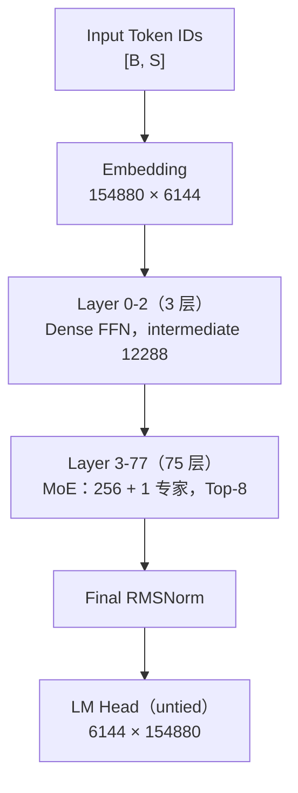
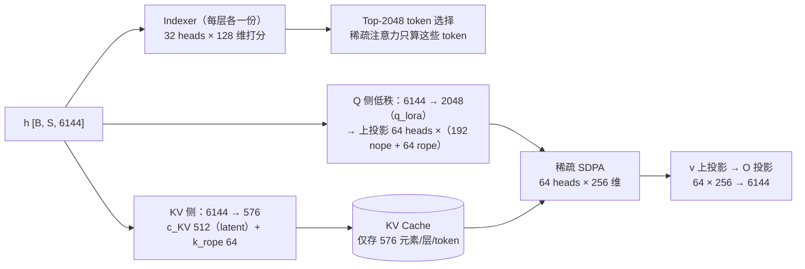
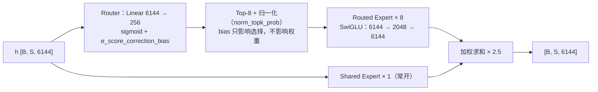

# GLM-5.1

`GLM-5 系列 · MoE · MLA + DSA · 744B 总参数 / 40B 激活 · 2026-04 发布 · MIT`

智谱 GLM-5 大底座的第一个公开迭代：78 层、256+1 专家 Top-8，注意力侧从 GLM-4.5 的 GQA **整体切换到 MLA + DSA**（latent KV 576 元素/层，稀疏 top-2048），每层独立 indexer。官方定位 agentic engineering 旗舰（SWE-Bench Pro / Terminal-Bench 长程任务），底座 GLM-5（2026-02，[技术报告 arXiv:2602.15763](https://arxiv.org/abs/2602.15763)）**全程在华为昇腾芯片上训练**。

## 规格总览

以下数值除注明外均取自 [HF config.json](https://huggingface.co/zai-org/GLM-5.1/raw/main/config.json)（本地快照 `data/models/raw/glm-5.1.json`）；参数量来自 transformers 官方文档。

| 项 | 值 |
| --- | --- |
| 模型类 | `GlmMoeDsaForCausalLM`（`model_type: glm_moe_dsa`） |
| 总参数 / 激活参数 | 744B / 40B（transformers 官方文档，GLM-5 底座口径，5.1/5.2/5.3 同底座） |
| 层数 | 78（`first_k_dense_replace = 3`：前 3 层 Dense，后 75 层 MoE） |
| Hidden Size | 6144 |
| Attention | **MLA + DSA**（全部 78 层）：`q_lora_rank 2048`，`kv_lora_rank 512`，`qk_nope 192 + qk_rope 64`（`qk_head_dim 256`），`v_head_dim 256`，Q Heads 64 |
| DSA Indexer | `index_topk 2048`，`index_n_heads 32`，`index_head_dim 128`；**每层独立 indexer**（config 无 `indexer_types`，无跨层共享） |
| RoPE | 仅作用于 64 维 rope 分量，`theta = 1e6`；`max_position_embeddings = 202752`（≈200K） |
| QKV Bias | 无（`attention_bias: false`——GLM-4.5 的 QKV bias 在 5 代移除） |
| Dense FFN | intermediate 12288（仅前 3 层） |
| MoE | 256 路由专家 + 1 共享专家，Top-8，`moe_intermediate_size = 2048` |
| Router | sigmoid + `e_score_correction_bias`（`noaux_tc`）+ `norm_topk_prob`，`n_group 1`，`routed_scaling_factor = 2.5`（沿用 GLM-4.5 学派） |
| MTP | `num_nextn_predict_layers = 1`（transformers 实现不含 MTP 层，官方文档） |
| Norm | RMSNorm，eps 1e-5，Pre-Norm |
| 词表 | 154880，untied |
| 权重精度 / 体积 | 主仓 BF16 · **1507.7 GB**；官方 FP8 版 756.2 GB（[GLM-5.1-FP8](https://huggingface.co/zai-org/GLM-5.1-FP8)）。体积为仓库 safetensors 实测总和（`data/models/weight_sizes.json`，下同） |
| KV Cache 精度 | 默认 **BF16**（MLA latent 576 × 78 层 ≈ 88 KiB/token，见 Attention 节）；官方无量化 KV 配置，FP8 KV 属框架侧通用能力 |

## 整体结构

## Attention：MLA + DSA（每层独立 indexer）

要点：

- **MLA 维度比 DeepSeek-V3 一代明显加宽**：nope 192 / v_head 256（V3 为 128/128），`q_lora_rank 2048`；KV Cache 与 head 数解耦，每层每 token 只存 `kv_lora 512 + rope 64 = 576` 元素。
- **KV Cache（BF16）**：`576 × 78 层 × 2B ≈ 88 KiB/token`——与 Hunyuan Hy4 相同的 latent 维度（两家均 512+64）；对比 GLM-4.5（GQA，368 KiB/token）压缩约 4.2 倍。DSA 索引缓存另计（top-k 下标，约 `2048 × 78 × 每元素开销`，实现相关）。
- **DSA 与 Hy4 的 IndexCache 差异**：GLM-5.1 的 78 层**每层独立跑 indexer**（config 无 `indexer_types` 字段），没有 Hy4 的跨层索引复用；跨层共享是 GLM-5.2 的 IndexShare 才引入（见 [GLM-5.2](/glm/glm-5.2/)）。
- config 顶层 `head_dim` 字段（5.1 为 64）在 MLA 下不参与注意力维度计算，实际以 `qk_nope/qk_rope/v_head` 为准（transformers `GlmMoeDsaConfig` 文档）。

## MoE：256 + 1 专家

- 路由实现沿用 GLM-4.5 已核实的 sigmoid + bias 学派（`Glm4MoeTopkRouter` 一脉），`n_group 1` 无组内筛选；5.2 起补充 `moe_router_dtype: float32`（路由打分强制 fp32）。
- **激活参数估算**：MoE ≈ 75 × (8+1) × 3 × 6144×2048 ≈ 25.5B；Dense 3 层 ≈ 1.4B；MLA 注意力（吸收后）≈ 12B 量级；Embedding + Head ≈ 1.9B；合计 ≈ **40B**，与官方 40B 一致。

## 演进

| 模型 | 时间 | 架构变化 |
| --- | --- | --- |
| GLM-4.5 / 4.6 | 2025-07 / 09 | GQA（8 KV head）+ Partial RoPE + QKV bias，357B A32B |
| GLM-4.7（-Flash） | 2025-12 | 同 4.5 架构迭代（页面待建） |
| **GLM-5** | 2026-02 | **换代：MLA + DSA**，744B A40B，200K ctx，昇腾全程训练（[arXiv:2602.15763](https://arxiv.org/abs/2602.15763)） |
| **GLM-5.1** | 2026-04 | 同底座训练迭代；agentic 长程能力大幅增强（本文） |
| GLM-5.2 | 2026-06 | IndexShare（每 4 层共享 indexer）+ 原生 1M ctx，见 [GLM-5.2](/glm/glm-5.2/) |
| GLM-5.3（-Flash） | 2026-08 | 同底座纯后训练升级；Flash 为混合线性新架构，见 [GLM-5.3](/glm/glm-5.3/) |

## 原始资料

- [Hugging Face 模型仓库](https://huggingface.co/zai-org/GLM-5.1)（模型卡 / config.json）
- [transformers `GlmMoeDsaConfig` 官方文档](https://huggingface.co/docs/transformers/en/model_doc/glm_moe_dsa)（744B/40B、indexer_types 语义、昇腾训练）
- [GLM-5 技术报告 arXiv:2602.15763](https://arxiv.org/abs/2602.15763)、[z.ai GLM-5.1 blog](https://z.ai/blog/glm-5.1)
- 部署：[SGLang cookbook（GLM-5.1）](https://cookbook.sglang.io/autoregressive/GLM/GLM-5.1)、[vLLM recipes GLM5](https://github.com/vllm-project/recipes/blob/main/GLM/GLM5.md)（vLLM v0.19.0+ / SGLang v0.5.10+）
- 本地 config 快照：`data/models/raw/glm-5.1.json`
