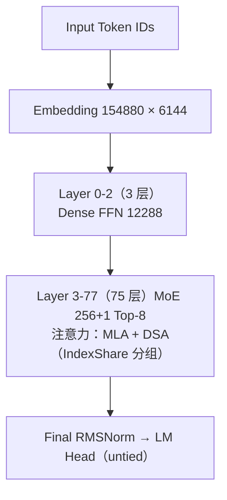
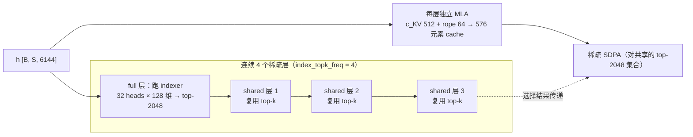

# GLM-5.2

`GLM-5 系列 · MoE · MLA + DSA（IndexShare）· 744B 总参数 / 40B 激活 · 2026-06 发布 · MIT`

GLM-5 底座的 1M 上下文版本：架构上唯一但关键的改动是 **IndexShare——每 4 个稀疏注意力层共享一次 indexer 的 top-k 选择**（官方称 1M ctx 下每 token 注意力 FLOPs 降低 2.9×），RoPE `theta` 提到 8e6，MTP 层改进使投机解码接受长度 +20%。官方定位 long-horizon 任务旗舰（Terminal-Bench 2.1 81.0，开源最强）。

## 规格总览

以下数值除注明外均取自 [HF config.json](https://huggingface.co/zai-org/GLM-5.2/raw/main/config.json)（本地快照 `data/models/raw/glm-5.2.json`）。

| 项 | 值 |
| --- | --- |
| 模型类 | `GlmMoeDsaForCausalLM`（`model_type: glm_moe_dsa`） |
| 总参数 / 激活参数 | 744B / 40B（与 GLM-5/5.1 同底座；GLM-5.3 官方声明与 5.2 同 base，全部后训练增益） |
| 层数 | 78（`mlp_layer_types`：前 3 层 dense，后 75 层 sparse） |
| Hidden Size | 6144 |
| Attention | MLA + DSA：`q_lora_rank 2048`，`kv_lora_rank 512`，`qk_nope 192 + qk_rope 64`，`v_head_dim 256`，Q Heads 64 |
| **IndexShare** | `indexer_types` 78 项：前 3 层 `full`，其余按 `full` + `shared×3` 循环（`index_topk_freq = 4`，`index_skip_topk_offset = 3`）；`shared` 层直接复用上一个 `full` 层的 top-k（transformers 文档） |
| DSA Indexer | `index_topk 2048`，`index_n_heads 32`，`index_head_dim 128`；`index_share_for_mtp_iteration = true`（MTP 迭代同样复用索引） |
| RoPE | `theta = 8e6`（5.1 为 1e6），仅 64 维 rope 分量；`max_position_embeddings = 1048576`（**原生 1M**） |
| Dense FFN | intermediate 12288（仅前 3 层） |
| MoE | 256 路由专家 + 1 共享专家，Top-8，`moe_intermediate_size = 2048`，`moe_router_dtype = float32` |
| Router | sigmoid + `e_score_correction_bias`（`noaux_tc`）+ `norm_topk_prob`，`routed_scaling_factor = 2.5` |
| MTP | `num_nextn_predict_layers = 1`，官方称接受长度较 5.1 最多 +20% |
| 词表 | 154880，untied |
| 权重精度 / 体积 | 主仓 BF16 · **1506.7 GB**；官方 FP8 版 755.6 GB（[GLM-5.2-FP8](https://huggingface.co/zai-org/GLM-5.2-FP8)）。体积为仓库 safetensors 实测总和（`data/models/weight_sizes.json`，下同） |
| KV Cache 精度 | 默认 **BF16**（MLA latent 576 × 78 层 ≈ 88 KiB/token，同 5.1）；官方无量化 KV 配置，FP8 KV 属框架侧通用能力 |

## 整体结构

## Attention：IndexShare——每 4 层算一次 top-k

要点：

- **IndexShare 与 Hy4 IndexCache 同构、密度更高**：Hy4 约每 5 层一个 full indexer，GLM-5.2 为每 4 层（`index_topk_freq = 4`）；且前 3 层（Dense FFN 层）固定 `full` 起步（`index_skip_topk_offset = 3`）。官方口径：1M ctx 下每 token 注意力 FLOPs ↓ 2.9×（[IndexShare 论文 arXiv:2603.12201](https://arxiv.org/abs/2603.12201)）。
- **KV Cache（BF16）**：与 5.1 相同 `576 × 78 × 2B ≈ 88 KiB/token`；IndexShare 节省的是**计算**（indexer 前向与 top-k 选择），不是 cache 容量。
- 1M ctx 的代价主要在 RoPE（theta 8e6）与训练数据长度外推，cache 容量不变（与序列长度线性相关）。
- MTP 迭代共享索引（`index_share_for_mtp_iteration`）：投机解码的多个 draft token 复用同一份 top-k，避免索引重算。

## MoE：256 + 1 专家（与 5.1 相同）

结构同 [GLM-5.1](/glm/glm-5.1/)：sigmoid + bias 路由、Top-8、`routed_scaling_factor 2.5`、共享专家 1 个。5.2 起路由打分固定 fp32（`moe_router_dtype`），对低精度部署的专家均衡更稳。

## 演进

| 模型 | 时间 | 相对上一代的变化 |
| --- | --- | --- |
| GLM-5.1 | 2026-04 | 每层独立 indexer，200K ctx（[页面](/glm/glm-5.1/)） |
| **GLM-5.2** | 2026-06 | **IndexShare（每 4 层共享 top-k）**；RoPE theta 1e6→8e6；原生 1M ctx；MTP 接受长度 +20%；路由 fp32 |
| GLM-5.3 | 2026-08 | 同 base 纯后训练升级（coding/cyber 强化），license 改为自定义（[页面](/glm/glm-5.3/)） |

## 原始资料

- [Hugging Face 模型仓库](https://huggingface.co/zai-org/GLM-5.2)（模型卡 / config.json）
- [IndexShare 论文 arXiv:2603.12201](https://arxiv.org/abs/2603.12201)（每 4 层共享 indexer、2.9× FLOPs）
- [z.ai GLM-5.2 blog](https://z.ai/blog/glm-5.2)、[GLM-5 技术报告 arXiv:2602.15763](https://arxiv.org/abs/2602.15763)
- [transformers `GlmMoeDsaConfig` 文档](https://huggingface.co/docs/transformers/en/model_doc/glm_moe_dsa)（indexer_types 语义）
- 本地 config 快照：`data/models/raw/glm-5.2.json`
