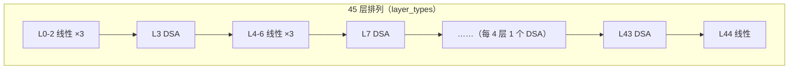

# GLM-5.3

`GLM-5 系列 · MoE · MLA + DSA（IndexShare）· 744B 总参数 / 40B 激活 · 2026-08 发布`

GLM-5.2 的纯后训练升级：**官方明确「与 GLM-5.2 同一 base model，所有增益来自 post-training」**（transformers 文档与模型卡原文）。能力焦点是复杂编码（自报 Z.ai Code Bench 较 5.2 +50%，Terminal-Bench 3.0 / Agents' Last Exam 开源 SOTA）与意外的网络安全能力（CyberGym 漏洞发现 SOTA）。license 从 5.2 的 MIT 收紧为自定义 `glm-5.3` 许可。同日发布的 **GLM-5.3-Flash 是独立的新架构**（混合线性注意力 + 多模态），见下文专节。

## 规格总览（GLM-5.3 本体）

config 与 GLM-5.2 完全一致（本地快照 `data/models/raw/glm-5.3.json` 与 `glm-5.2.json` 逐字段对比，仅 transformers_version 等元数据不同）：

| 项 | 值 |
| --- | --- |
| 模型类 | `GlmMoeDsaForCausalLM`（`model_type: glm_moe_dsa`） |
| 总参数 / 激活参数 | 744B / 40B（GLM-5 底座；GLM-5.3 官方声明与 5.2 同 base） |
| 层数 / Hidden | 78 层（3 Dense + 75 MoE）/ 6144 |
| Attention | MLA + DSA：`kv_lora 512 + qk_rope 64 = 576` 元素 cache/层，`qk_nope 192`，`v_head 256`，Q Heads 64 |
| IndexShare | `index_topk_freq 4`（每 4 层一次 indexer top-2048，前 3 层 full 起步） |
| 上下文 | 原生 1M（`max_position_embeddings 1048576`，RoPE theta 8e6） |
| MoE | 256 + 1 专家，Top-8，sigmoid + bias（`noaux_tc`），scaling 2.5，router fp32 |
| MTP | 1 层（`num_nextn_predict_layers`），`index_share_for_mtp_iteration` |
| License | 自定义 `glm-5.3`（5.2 为 MIT；另有 BF16 权重仓库 GLM-5.3-BF16） |
| 权重精度 / 体积 | **主仓即为 FP8** · **755.6 GB**（与 5.2 同底座）；[GLM-5.3-BF16](https://huggingface.co/zai-org/GLM-5.3-BF16) 1506.7 GB。体积为仓库 safetensors 实测总和（`data/models/weight_sizes.json`，下同） |
| KV Cache 精度 | 默认 **BF16**（同 5.2：MLA latent ≈ 88 KiB/token）；官方无量化 KV 配置，FP8 KV 属框架侧通用能力 |

结构与机制详见 [GLM-5.2](/glm/glm-5.2/)（IndexShare 计算、MLA 吸收路径、KV Cache ≈88 KiB/token 均相同）；`reasoning_effort` 支持 `low/high/max` 三档思考预算（默认 max，模型卡）。

## GLM-5.3-Flash：混合线性注意力新架构（320B / A18B）

系列首个**原生多模态**模型（`Glm5NextForConditionalGeneration`，含 24 层 ViT 视觉塔）。文本侧是全新的混合架构：**34 层线性注意力（KDA）+ 11 层 DSA 稀疏注意力**，官方口径 320B 总参 / 18B 激活，官方权重即 FP8。数值取自 [config](https://huggingface.co/zai-org/GLM-5.3-Flash/raw/main/config.json)（本地快照 `data/models/raw/glm-5.3-flash.json`，`text_config`）。

| 项 | 值 |
| --- | --- |
| 模型类 | `Glm5NextForConditionalGeneration`（`model_type: glm5_next`，text `glm5_next_text`） |
| 总参数 / 激活参数 | 320B / 18B（官方模型卡：「outperforms GLM-5.2 … at one-tenth the price」） |
| 层数 / Hidden | 45 层（`layer_types`：3 层线性 + 之后每 4 层 1 层 DSA，即 Layer 3,7,…,43 共 11 层 DSA + 34 层线性）/ 4096 |
| 线性注意力（KDA） | `linear_attn_config`：64 heads × 128 维，`short_conv_kernel_size 4`，`gate_lower_bound -5.0`；权重名含 `A_log / dt_bias / g_a_proj / g_b_proj / k_conv1d`——Gated DeltaNet（KDA）家族签名 |
| DSA 层 MLA | `kv_lora_rank 512`，`qk_nope 256`，**`qk_rope_head_dim = 0`（主干注意力无 RoPE）**，`mla_use_nope: true`，`v_head 256`，`q_lora_rank 1536` |
| DSA Indexer | topk 2048，32 heads × 128 维；全部 `full`（无 IndexShare）；**k-pool 压缩**：`index_kpool 4`，`index_kpool_compress` + `_ape/_gate` 权重，`always_select_tail: true` |
| 残差 | **MHC**（`mhc: true`）：`hc_mult 4` 条残差流 + `hc_sinkhorn_iters 20`（Sinkhorn 双随机化——比 Hy4 iHC 的 identity 版更重） |
| MoE | 288 路由 + 1 共享，Top-8，sigmoid + bias，`moe_inter 2048`，前 3 层 dense |
| 量化 | 官方权重 FP8（`fmt e4m3`，block 128×128，dynamic activation；attention/hyper-connection/indexer 等模块保持高精度）· **328.3 GB**；[BF16 版](https://huggingface.co/zai-org/GLM-5.3-Flash-BF16) 642.7 GB。体积为仓库 safetensors 实测总和（`data/models/weight_sizes.json`） |
| MTP | 1 层（`index_share_for_mtp_iteration`，`eh_proj/enorm/hnorm` DeepSeek 式结构） |
| 上下文 / 词表 | 1M / 154880 |

- **无 RoPE 的 MLA**：DSA 层 `qk_rope_head_dim = 0`，KV cache 每层仅 512 元素 latent（无 rope 分量）；位置信息由线性层的短卷积/递推与 indexer 自带 RoPE（`indexer_rope_interleave`）承担。34/45 层完全无 attention cache（线性状态固定大小），KV 显存压力远低于 5.2 本体。
- **k-pool 索引压缩**：indexer 引入 `index_kpool 4`——KV 侧先压缩进可学习池再参与索引打分（`compress` + gate + APE），并保证近期 token（tail）必选（`always_select_tail`）；这是 DSA indexer 的加宽变体，具体语义待官方文档/论文补充（**待核实**）。
- 视觉塔：24 层 ViT（hidden 1024，patch 14 / 448 输入，spatial merge 2，输出投影到 4096 对齐文本）。
- 激活构成推算：MoE 42 层 × 9 × 3 × 4096×2048 ≈ 9.5B + 线性/DSA/attention/embedding ≈ 18B 总激活，与官方一致（推算）。

## 演进

| 模型 | 时间 | 要点 |
| --- | --- | --- |
| GLM-5.2 | 2026-06 | 744B A40B，IndexShare + 1M，MIT（[页面](/glm/glm-5.2/)） |
| **GLM-5.3** | 2026-08 | 同 base 纯后训练：coding +50%（自报）、CyberGym SOTA；license 收紧 |
| **GLM-5.3-Flash** | 2026-08 | **新混合架构**：34 线性（KDA）+ 11 DSA + MHC + 无 RoPE MLA + k-pool，320B A18B，FP8 官方，原生多模态 |

## 原始资料

- [GLM-5.3 模型卡](https://huggingface.co/zai-org/GLM-5.3) / [GLM-5.3-Flash 模型卡](https://huggingface.co/zai-org/GLM-5.3-Flash)（同 base 声明、320B/18B、多模态定位）
- [transformers `GlmMoeDsaConfig` 文档](https://huggingface.co/docs/transformers/en/model_doc/glm_moe_dsa)（GLM-5 系列实现；MTP 不含在 transformers 实现中）
- [GLM-5 技术报告 arXiv:2602.15763](https://arxiv.org/abs/2602.15763)、[IndexShare arXiv:2603.12201](https://arxiv.org/abs/2603.12201)
- 本地 config 快照：`data/models/raw/glm-5.3.json`、`data/models/raw/glm-5.3-flash.json`
