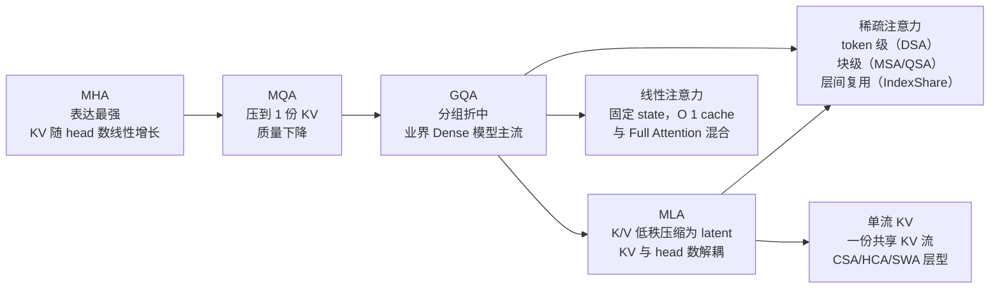

# Attention 变体总览

解码自回归模型的 Attention 设计，本质是在 **表达能力、KV Cache 大小、解码访存量** 三者之间取舍。六家厂商的路线可以放进同一条演进线看。2026 年的新变量：**稀疏注意力分化出三派、混合线性注意力从试验田走向主力、KV Cache 进入亚 KiB 时代（FP4）**。

## 一页看懂：KV Cache 每 token 每层的元素数

| 变体 | 每 token 每层 KV 元素 | 公式 | 代表模型 |
| --- | --- | --- | --- |
| MHA | `2 × H × d` | 完整 K/V 各 H 份 | GLM-130B、Qwen1 |
| MQA | `2 × d` | 所有 Q head 共享 1 份 KV | （过渡方案，少见） |
| GQA | `2 × H_kv × d` | 分组共享 KV | Qwen3（4 KV head）、GLM-4.5（8）、Hunyuan Hy3（8）、MiniMax-M2/M3（4） |
| MLA | `kv_lora_rank + qk_rope_head_dim`（latent） | K/V 压缩进单一 latent 向量 | DeepSeek-V3 / Kimi-K2（576）、GLM-5（576）、Hunyuan Hy4（576） |
| **MLA 不吸收（K3 式）** | `(d_k + d_v) × H`（per-head 展开） | 放弃权重吸收，cache 直接存展开 K/V | Kimi-K3（30,720/层/token） |
| **单流 KV（V4 式）** | `1 × 512`（+ 分组低秩 O 侧） | 一份 512 维共享 KV 流 + CSA/HCA/SWA 层型 | DeepSeek-V4-Pro/Flash |
| DSA / NSA / MSA / QSA | 同底座（MLA/GQA），**计算稀疏化** | indexer 选 top-k token/block 参与注意力 | DeepSeek-V3.2/V4（top-2048→512）、GLM-5（2048）、Hy4（2048）、MiniMax-M3（block）、Qwen Flash-Next（block） |
| 线性注意力 | 固定大小 state（与序列长度无关） | RNN 式状态递推 | Qwen3.5/3.8 全系（GDN）、Kimi-K3（KDA）、GLM-5.3-Flash（KDA） |

以 2026-10 旗舰为例（BF16 口径，全模型每 token，混合模型另计固定 state）：

- [Qwen3.8-2.4T-A95B](/qwen/qwen3.8/)：3:1 混合 → ≈92 KiB/token **+ 276 MiB 固定 state**（同级 235B 全 GQA 的 1/6）
- [GLM-5.3](/glm/glm-5.3/)：MLA 576 × 78 层 → ≈88 KiB/token
- [Hunyuan Hy4-preview](/hunyuan/hy4-preview/)：≈88 KiB + DSA 索引缓存 ≈95 KiB（FP8 口径）
- [MiniMax-M3](/minimax/minimax-m3/)：GQA 4 head × 60 层 → 120 KiB/token（1M token ≈114 GB）
- [Kimi-K3](/kimi/kimi-k3/)：**不吸收 MLA → 1.41 MiB/token**（K2 的 ~21×）+ KDA 固定 221.6 MiB——用 KV 换 kernel 简化的极端样本
- [DeepSeek-V4.1-Flash](/deepseek/deepseek-v4.1-flash/)：**FP4 主 KV → 890 B/token**——跨层共享（CSA2）+ 4-bit 的叠加效果

## 演进动机

## 稀疏注意力三派（2026 分化）

不改 cache 布局（或改得很轻），改**参与计算的 token 集合**。三家切法：

| 派系 | 选择粒度 | 代表 | indexer 结构 |
| --- | --- | --- | --- |
| **token 级**（DSA 原教旨） | 每 query 选 top-k 单 token（2048→512 递减） | DeepSeek-V3.2（64×128）、GLM-5（32×128）、Hy4（IndexCache） | 小 MLP + RoPE，全层共享头 |
| **块级**（MSA/QSA） | 选 top-k 个 block（128/4 token 块）+ local block | MiniMax-M3（Top-16×128 block）、Qwen Flash-Next（QSA，budget 2048 = Top-512×4） | 块内 max 池化打分，exp-free top-k |
| **层间复用**（IndexShare/CSA2） | 每 N 层算一次 top-k，中间层复用 | GLM-5.2（每 4 层）、Hy4（每 5 层）、V4.1（CSA2 Full/Reindex/Reuse 三模式） | 把 indexer 计算摊薄到 1/N |

常配可学习 sink token / local block 兜底。效果：长上下文注意力 FLOPs 与访存从 O(S) 降到 O(k)。**indexer 自身的 cache 是隐藏成本**（V3.2 的 indexer key cache 是 MLA latent 的 14 倍，需 FP8 缓解）。

## 各变体要点

### GQA（Grouped Query Attention）

投影出 `H_kv` 份 K/V，每 `H / H_kv` 个 Q head 共享一份。实现最简单、与标准 attention kernel 兼容最好；KV 压缩靠减少 `H_kv`。关键取舍：`H_kv` 越小 cache 越省，但长序列质量风险越高。2026 年仍在 M3（4 head）、Hy3（8 head）等模型上主力使用，Qwen3.5 的 full 层升级为 Gated Attention（head_dim 256 + partial RoPE 64 维 + 输出 sigmoid 门）。Hy3 是一个干净的对照样本：8 KV × 128 × 80 层 = 320 KiB/token，两个月后的 Hy4 换 MLA+DSA 降到 ≈88–95 KiB/token。

### MLA（Multi-head Latent Attention）

详见 [DeepSeek-V3 页](/deepseek/deepseek-v3/) 的完整计算图。核心：K/V 先压成 `c_KV`（latent），cache 只存 latent + rope 分量；解码时通过权重吸收（`W_UK` 并 Q 侧、`W_UV` 并 O 侧）直接在 latent 空间算注意力。DeepSeek / GLM-5 / Hy4 / K2 的选择。**K3 反例**：`mla_use_output_gate` 需要每头独立变换，权重吸收不再成立，cache 直接存 per-head 展开结果（30,720 元素/层/token）——「MLA 的 KV 优势来自吸收，而吸收与门控互斥」是 2026 年的重要教训。**V4 再反例**：干脆放弃 latent 范式，单份 512 维共享 KV 流（kv_heads=1）+ O 侧分组低秩。

### 线性注意力（Gated DeltaNet / KDA / Lightning）

把 attention 改写为固定大小状态的递推，cache 不随序列增长；纯线性注意力难以替代 softmax，实践上都是**与 Full Attention 按层混合**。2025 年的 Qwen3-Next / Kimi-Linear-48B 还是试验田，**2026 年已成主力架构**：Qwen3.5/3.8 全系 3:1（full 层在 `idx ≡ 3 mod 4`）、Kimi-K3 69:24、GLM-5.3-Flash 34:11；MiniMax 是唯一「先混合（7:1 Lightning）、后放弃（M2 全 softmax）、再稀疏化（M3 MSA）」的完整样本。GLM-5.3-Flash 更进一步把 full 层换成 DSA（混合线性 + 稀疏）。

## 关联页面

- [MoE 总览](/guide/moe/)
- 各厂商：[Qwen](/qwen/) · [DeepSeek](/deepseek/) · [GLM](/glm/) · [Kimi](/kimi/) · [MiniMax](/minimax/) · [Hunyuan](/hunyuan/)
