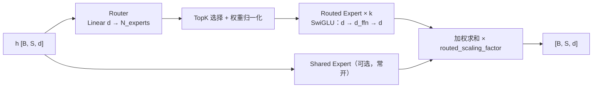

# MoE 总览

MoE（Mixture of Experts）用**稀疏激活**把「总参数」与「每 token 计算量」解耦：一个 Router 为每个 token 选出 k 个专家，其余专家不参与计算。六家厂商的 MoE 已收敛到相近骨架，差异集中在路由打分与负载均衡；2026 年的新变量是**路由函数第三学派（sqrtsoftplus）、LatentMoE 结构创新、FP4/MXFP4 原生量化专家**。

## 通用结构

## 六家路由方式对照（以已收录模型为准）

### 2025 世代

| 模型 | 专家数 | TopK | 共享专家 | 打分 | 负载均衡 | 备注 |
| --- | --- | --- | --- | --- | --- | --- |
| [Qwen3-30B-A3B](/qwen/qwen3-30b-a3b/) | 128 | 8 | 无 | softmax + 归一化 | 微量 aux loss（1e-3） | 每层都为 MoE |
| [DeepSeek-V3](/deepseek/deepseek-v3/) | 256 | 8 | 1 | **sigmoid + bias** | aux-free（bias 只影响选择） | 组内两级筛选（8 组选 4） |
| [GLM-4.5](/glm/glm-4.5/) | 160 | 8 | 1 | sigmoid + bias | aux-free | 无组内筛选 |
| [Kimi-K2](/kimi/kimi-k2/) | 384 | 8 | 1 | sigmoid + bias | aux-free | 无组内筛选 |
| [MiniMax-M2](/minimax/minimax-m2/) | 256 | 8 | 无 | sigmoid + bias | aux-free | 全层 MoE，无 Dense 前置层 |
| Hunyuan Hy4 | 256 | 8 | 1 | sigmoid（config 无 bias 字段） | — | 首层 Dense，其余 MoE |

### 2026 世代

| 模型 | 专家数 | TopK | 共享专家 | 打分 | 专家精度 | 备注 |
| --- | --- | --- | --- | --- | --- | --- |
| [Qwen3.5-397B-A17B](/qwen/qwen3.5/) | 512 | 10 | 1（**门控**） | softmax + 归一化（延续） | BF16 | 共享专家带 `sigmoid(gate)` 独立门控；[3.8-2.4T](/qwen/qwen3.8/) 同构放大 |
| [GLM-5.3](/glm/glm-5.3/) | 256 | 8 | 1 | sigmoid + bias（延续） | BF16（router fp32） | 与 4.5 相同；5.3-Flash 为 288+1 |
| [Kimi-K3](/kimi/kimi-k3/) | **896** | **16** | **2** | sigmoid + noaux_tc | **MXFP4** | **LatentMoE**：共享投影把路由专家放进 3584 维 latent 空间（每专家 33M） |
| [MiniMax-M3](/minimax/minimax-m3/) | 128 | 4 | 1 | sigmoid + bias | BF16（M3.1 QAT MXFP8） | **反转细粒度趋势**：少而宽（专家 dim 3072） |
| [Hunyuan Hy3](/hunyuan/hy3/) | 192 | 8 | 1 | sigmoid + bias | BF16（另有 FP8 版） | 末代 GQA 旗舰，scaling 2.826；[Hy4](/hunyuan/hy4-preview/) 同路线（256+1，config 无 bias 字段） |
| [DeepSeek-V4-Pro](/deepseek/deepseek-v4/) | 384 | 6 | 1 | **sqrtsoftplus + noaux_tc** | **FP4** | **前 3 层 hash_moe**（冻结 token-id→专家查表，零路由计算） |

> 路由三派：**softmax 派**（Qwen，权重天然归一化）· **sigmoid + bias 派**（DeepSeek 系，sigmoid 分数 + 选择性 bias，bias 不进门控值，被 GLM / Kimi / MiniMax / Hunyuan 继承）· **sqrtsoftplus 派**（DeepSeek-V4，`√ln(1+eˣ)`，分数更平缓 + 同样 aux-free）。

## 关键设计点

- **细粒度专家**：把专家切小、多选几个（V3：256 选 8；K2：384 选 8；K3 极端化为 896 选 16），组合空间大、等效容量高。**M3 反向操作**（128 选 4、专家加宽到 3072）说明细粒度并非唯一方向。
- **LatentMoE（K3）**：共享 down/up 投影让路由专家在 3584 维 latent 空间工作（而非 7168 hidden），每专家参数省半——MoE 结构层面的参数效率创新。
- **hash_moe（V4）**：前 3 层不做学习路由，token id 直接查表选专家，浅层「路由不值得学」的极端化。
- **Dense 前置层**：`first_k_dense_replace`——浅层不做路由（V3/GLM：3 层，K2/Hy4：1 层，K3：1 层；V4 用 hash_moe 替代该思路）。
- **共享专家**：常开专家承载公共知识。数量也在分化：Qwen3/M2 用 0，多数用 1，K3 用 2；Qwen3.5 起共享专家带独立 sigmoid 门控。
- **routed_scaling_factor**：路由输出整体缩放（V3/GLM/V4：2.5；M3：2.0；K3：1.0——LatentMoE 结构下不再需要幅度补偿）。
- **激活参数估算**：`≈ L_moe × k × 3 × d × d_ffn + L_dense × 3 × d × d_ffn_dense + Attention + Embedding`，各模型页给出了逐项估算（K3 需按 latent 维度 3584 算专家项）。

## 推理工程视角

- **Expert Parallel（EP）**：专家多、单卡放不下时按专家切分，引入 all-to-all 通信；K3（896 专家 + 2.8T 总参）的官方部署口径即 TP8/EP16 + P/D 分离，MoE kernel 建议 `deep_gemm_mega_moe`。
- **batch 敏感**：TopK 路由使不同 token 激活不同专家，大 batch 才能摊平专家权重加载；decode 阶段小 batch 是 MoE 推理的天然弱势场景。Top-k 越大（K3 的 16）单 token 激活专家越多，对 batch 的敏感度反而下降，但通信扇出上升。
- **量化**：专家权重占参数大头（>90%），2026 年旗舰直接以 **FP4（V4）/ MXFP4（K3）/ QAT MXFP8（M3.1）** 发布——量化从部署期选项变成训练期决定；router gate 与 bias 仍保持高精度（M3.1 的 MXFP8 明确 57 层 router gate 全不量化）。

## 关联页面

- [Attention 变体总览](/guide/attention/)
- 各厂商：[Qwen](/qwen/) · [DeepSeek](/deepseek/) · [GLM](/glm/) · [Kimi](/kimi/) · [MiniMax](/minimax/) · [Hunyuan](/hunyuan/)
