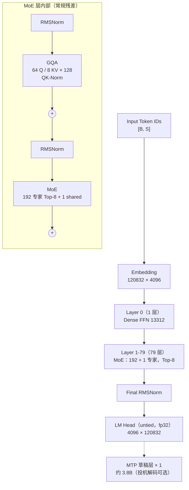
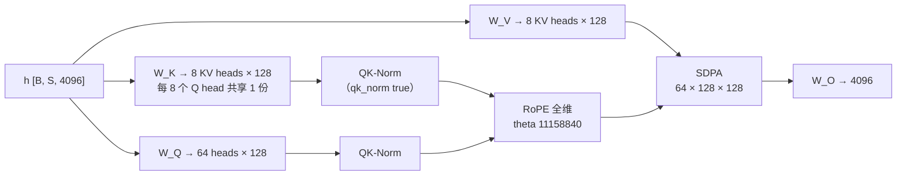
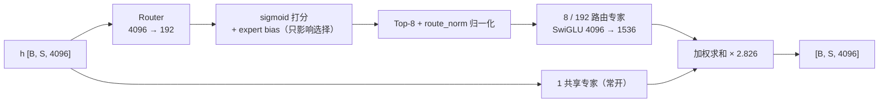

# Hunyuan Hy3

`Hunyuan Hy 系列 · MoE · GQA · 295B 总参数 / 21B 激活 · 2026-07 发布 · Apache-2.0`

腾讯混元第三代主力模型（前史：Hy3 Preview 2026-04 末，正式版 2026-07-02 上线 HF）：80 层（Layer 0 Dense，其余 79 层 MoE：192 路由 + 1 共享专家，Top-8）+ 1 层 MTP 草稿层（3.8B）。架构是**上一代范式的高完成度收官**——GQA（64Q/8KV）+ sigmoid+bias 路由 + MTP + 原生 256K，没有 MLA / 稀疏注意力 / 线性层；这些激进元件全部留给了两个月后的 [Hy4-preview](/hunyuan/hy4-preview/)。定位是中等规模效率旗舰：官方口径「对标 2-5× 参数量的旗舰开源模型」，270 人盲测 2.67/4 胜过 GLM-5.1（2.51/4）。

## 规格总览

以下数值除注明外均取自 [HF config.json](https://huggingface.co/tencent/Hy3/raw/main/config.json)（本地快照 `data/models/raw/hy3.json`）；参数规模与部署数字来自官方模型卡。

| 项 | 值 |
| --- | --- |
| 模型类 | `HYV3ForCausalLM`（`model_type: hy_v3`，transformers 5.6.0） |
| 总参数 / 激活参数 | 295B / 21B（模型卡口径）；另有 MTP 层 3.8B |
| MTP | `num_nextn_predict_layers = 1`（约 3.8B；vLLM `--speculative-config.method mtp`） |
| 层数 | 80（Layer 0 Dense，`first_k_dense_replace 1`，其余 79 层 MoE） |
| Hidden Size | 4096 |
| Attention | **GQA**：64 Q heads / 8 KV heads，`head_dim 128`，`qk_norm true`（全维 RoPE，`rope_theta 11158840`） |
| 上下文 | 262144（256K 原生） |
| Dense FFN | intermediate 13312（仅 Layer 0），SiLU |
| MoE | 192 路由专家 + 1 共享，Top-8；`expert_hidden_dim 1536` / `moe_intermediate_size 1536`；sigmoid 打分 + expert bias（`moe_router_use_sigmoid` / `moe_router_enable_expert_bias` 均为 true），`route_norm`，`router_scaling_factor 2.826` |
| 数值精度 | BF16 计算（`enable_lm_head_fp32 true`，attention softmax / MoE combine 不强制 fp32） |
| 权重精度 / 体积 | 主仓 BF16 · **597.6 GB**；官方 FP8 版 299.9 GB（[Hy3-FP8](https://huggingface.co/tencent/Hy3-FP8)）。体积为仓库 safetensors 实测总和（`data/models/weight_sizes.json`，下同） |
| KV Cache 精度 | 默认 **BF16**（320 KiB/token，见 Attention 节）；官方无量化 KV 配置，FP8 KV 属框架侧通用能力 |
| 词表 | 120832，untied |
| 部署 | 官方推荐 8×GPU（H20-3e 或更大显存）；vLLM（发布时需源码编译）/ SGLang 均有官方 recipe |

## 整体结构

- **激活参数估算（推算，≈官方 21B）**：MoE FFN 79 × (8+1) × 3 × 4096 × 1536 ≈ 13.4B；Attention 80 × ≈75.5M ≈ 6.0B；Dense FFN 0.16B；LM Head ≈ 0.5B；合计 ≈ 20.1B（与模型卡 21B 的差额来自 qk_norm 等小项）。
- 总参数推算 ≈ 295B：79 × 192 × 3 × 4096 × 1536 ≈ 287B 专家 + 注意力 6B + Embedding（untied 双份 ≈ 1B）+ Dense/MTP 外围，与官方口径一致。

## Attention：GQA（末代 GQA 旗舰）

- **KV Cache 核算（核心推理数字）**：每 token 每层 `2 × 8 × 128 = 2048` 元素，80 层 → 163,840 元素/token = **320 KiB/token（BF16）**。1M 序列需 320 GB——Hy3 原生 256K（80 GB KV），长上下文场景是 GQA 的明显短板。
- 与后继对比：Hy4-preview 换 Gated MLA + DSA 后 KV 降到 ≈88–95 KiB/token（含 FP8 索引缓存），**3.4× 压缩**正是那次换代的主要动因之一。
- QK-Norm 开启（`qk_norm true`）；config 未设 partial RoPE（全维旋转）。

## MoE：192 专家 Top-8 + sigmoid + bias

- 路由是 **DeepSeek 学派**（sigmoid + 选择性 bias，无 aux loss），`moe_router_enable_expert_bias true`；`router_scaling_factor 2.826`（与 Kimi-K2 / Hy4 的 2.827 几乎同值）。
- 专家规格「细而浅」：192 个 `1536` 维专家（对比 Hy4 是 256 个 `2048` 维），总池 287B 中激活 13.4B，稀疏度 ≈ 4.7%。
- config 的部署旋钮：`use_grouped_mm false`（未启用分组矩阵乘路径）、`enable_moe_fp32_combine false`。

## 与 Hy4-preview 对比（单代际最大跳跃）

| 维度 | Hy3（2026-07） | [Hy4-preview](/hunyuan/hy4-preview/)（2026-08） |
| --- | --- | --- |
| 参数 / 激活 | 295B / 21B（+3.8B MTP） | 770B / 49B（+10B MTP） |
| Attention | GQA 64Q/8KV × 128，QK-Norm | **Gated MLA**（latent 576）+ **DSA top-2048** |
| 稀疏 / 复用 | 无 | IndexCache（每 5 层 full indexer） |
| 残差 | 常规加法 | **iHC 4 残差流** |
| MoE | 192+1 Top-8（dim 1536） | 256+1 Top-8（dim 2048） |
| 上下文 | 256K | 1M |
| KV Cache | **320 KiB/token** | ≈88–95 KiB/token |

两个月内完成 GQA→MLA+DSA、加法残差→iHC、256K→1M 的三连跳，是本库收录范围内单代际变化最大的一次换代。

## 演进

| 模型 | 发布 | 说明 |
| --- | --- | --- |
| Tencent-Hunyuan-Large | 2024-11 | 389B A52B，GQA + CLA，首个开源 MoE 旗舰之一 |
| Hunyuan-A13B | 2025-06 | 80B A13B，细粒度 MoE，256K |
| Hy3 Preview | 2026-04（末） | Hy3 前身，50+ 产品反馈迭代 |
| **Hy3** | 2026-07-02 | 本页；295B / 21B，Apache-2.0 |
| Hy4-preview | 2026-08 | Gated MLA + DSA + iHC，770B / 49B，1M |
| Hy 生态衍生 | 2026-07~10 | Hy-MT2 / Hy-Memory / Hy-SimulMT / Hy-Nomas 等 30B-A3B 级专用模型（翻译 / 长期记忆写入 / 同传），独立产品线 |

## 原始资料

- [Hugging Face 模型仓库](https://huggingface.co/tencent/Hy3)（2026-07-02 上线，Apache-2.0；[FP8 版](https://huggingface.co/tencent/Hy3-FP8) 2026-07-04）
- 官方模型卡（总参 / 激活 / MTP / 盲测 / 部署建议，见仓库 README）
- [vLLM recipes：Hy3](https://recipes.vllm.ai/tencent/Hy3)（发布时需源码编译）、[SGLang cookbook：Hy3](https://lmsysorg.mintlify.app/cookbook/autoregressive/Tencent/Hy3)
- 后继：[Hy4-preview](/hunyuan/hy4-preview/)（本库详情页）
- 本地 config 快照：`data/models/raw/hy3.json`
