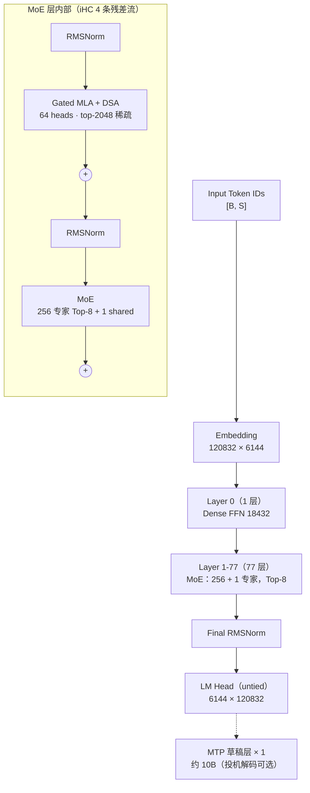
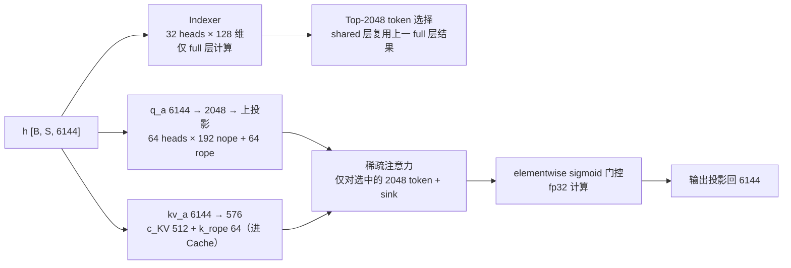
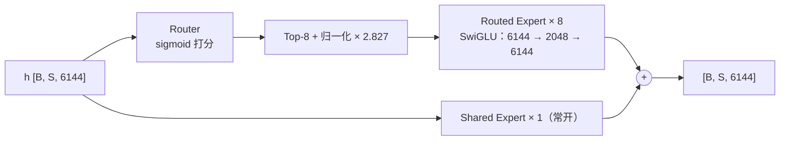

# Hunyuan Hy4-preview

`Hunyuan Hy 系列 · MoE · Gated MLA + DSA · 770B 总参数 / 49B 激活 · 2026-08 发布 · Apache-2.0`

腾讯混元第四代旗舰的 preview 版本：78 层（Layer 0 Dense，其余 77 层 MoE：256 路由 + 1 共享专家，Top-8）。注意力侧首次放弃前代 GQA，改用 **Gated MLA（低秩 KV 压缩 + elementwise 门控 + learnable sink）+ DSA 稀疏注意力**（每 query 仅 top-2048 token，IndexCache 跨层索引复用），残差通路为 iHC 多残差流，原生 1M 上下文；另含 1 层约 10B 的 MTP 草稿层（不计入 770B/49B 主干口径）。2026-08-27 上线 HF（preview），官网公告 2026-09-21。

## 规格总览

以下数值除注明外均取自 [HF config.json](https://huggingface.co/tencent/Hy4-preview/raw/main/config.json)（本地快照 `data/models/raw/hy4-preview.json`）；参数规模与部署数字来自官方模型卡 / transformers 文档 / SGLang cookbook，标注「推算」的为算术推导。

| 项 | 值 |
| --- | --- |
| 模型类 | `HYV4ForCausalLM`（`model_type: hy_v4`） |
| 总参数 / 激活参数 | 770B / 49B（backbone，不含 MTP）；含 MTP 草稿层约 780B（transformers 文档口径） |
| MTP | `num_nextn_predict_layers = 1`，草稿层约 10B 总参 / 0.7B 激活（`mtp_loss_factor 0.1`） |
| 层数 | 78（`mlp_layer_types`：Layer 0 Dense，1–77 MoE） |
| Hidden Size | 6144 |
| Attention | Gated MLA + DSA（全部 78 层）：`q_lora_rank 2048`，`kv_lora_rank 512`，`qk_nope 192 + qk_rope 64`（`qk_head_dim 256`），`v_head_dim 256`，Q Heads 64 |
| DSA Indexer | `index_topk 2048`，`index_n_heads 32`，`index_head_dim 128`，`learnable_sink true`（init 0.0）；full/shared 按 `indexer_types` 排列 |
| 门控 | `gated_mla: true`，`gating_type: elementwise`（fp32 逐通道 sigmoid 门控注意力输出） |
| RoPE | `theta = 1e7`，原生 `max_position_embeddings = 1048576`（1M） |
| 残差 | iHC（identity Hyper-Connections）：`hc_mult 4` 条并行残差流（`hc_magnitude 2.0` / `hc_eps 1e-6` 精确作用待核实） |
| Dense FFN | intermediate 18432，SwiGLU（`swiglu_limit 10.0` 限幅） |
| MoE | 256 路由专家 + 1 共享专家，Top-8（sigmoid 打分），`moe_intermediate_size 2048`，`norm_topk_prob`，`routed_scaling_factor 2.827` |
| 词表 | 120832，untied，BF16（另有 FP8 权重版） |
| 权重精度 / 体积 | 主仓 BF16 · **1560.0 GB**；官方 FP8 版（TensorRT modelopt）813.8 GB（[Hy4-preview-FP8](https://huggingface.co/tencent/Hy4-preview-FP8)）。体积为仓库 safetensors 实测总和（`data/models/weight_sizes.json`，下同） |
| KV Cache 精度 | 默认 **BF16**（latent ≈88 KiB/token）；SGLang 口径 **FP8 索引缓存**（含索引 ≈95 KiB/token，见 Attention 节） |

## 整体结构

- **full / shared indexer 排列**（`indexer_types`）：Layer 0、1 与 5, 9, …, 77（间隔 4）标记 `full`，其余标记 `shared`。依据 transformers `HYV4Config` 文档：只有 `full` 层运行 indexer 计算 token 选择，`shared` 层直接复用上一个 full 层的选择结果（官方称 IndexCache，跨层稀疏索引复用）。
- 每 token 激活约 49B：MoE FFN ≈ 77 × (8+1) × 3 × 6144×2048 ≈ 26B（推算），其余来自 attention、Embedding / LM Head 等。
- 残差通路不是普通加法：iHC 在层内维护 4 条并行残差流，每个子层前折叠、后重分发（transformers `HYV4Config` 文档）。

## Attention：Gated MLA + DSA

要点：

- **MLA 压缩路径**：Q 侧先压到 2048 再上投影 64 个 head（每 head 192 nope + 64 rope）；KV 侧整序列压成 512 维 latent `c_kv`，RoPE 分量单独 64 维——KV Cache 与 head 数无关，每层每 token 只存 576 个元素。维度比 DeepSeek-V3（512+64 但 nope 128 / v 128）明显更宽：nope 192、v_head 256。
- **KV Cache（BF16）**：`576 × 78 层 × 2B ≈ 88 KiB/token`；叠加 DSA 的 FP8 索引缓存后，SGLang cookbook 总口径 **≈ 95 KiB/token**。单条 1M token 序列 KV Cache 约 100 GB（推算）——Hy4 长上下文部署的主要显存开销。
- **DSA 稀疏检索**：每个 query 只对 indexer 选出的 top-2048 token 计算注意力；indexer 是 32 head × 128 维的轻量打分器。full 层约每 5 层一次（间隔 4），中间层免费复用。
- **Gated MLA 与 sink**：注意力输出过 fp32 的逐通道 sigmoid 门控；每个 head 有可学习 sink logit 参与 softmax 但不贡献 value（GPT-OSS 式，`learnable_sink: true`）。

## MoE：256 + 1 专家

- 路由为 sigmoid 打分 + Top-8 + `norm_topk_prob` 归一化 + `routed_scaling_factor 2.827`（与 Kimi-K2 同值）；config 中无 `e_score_correction_bias` 字段（与 DeepSeek-V3 / MiniMax-M2 不同）。
- 专家 SwiGLU 带 `swiglu_limit 10.0` 激活限幅；首层（Layer 0）不路由，为 Dense FFN 18432。
- 通用背景见 [MoE 总览](/guide/moe/)。

## 推理部署速查

来源：官方模型卡与 SGLang cookbook。

| 配置 | 权重格式 | 并行 | 最大上下文 |
| --- | --- | --- | --- |
| H200 × 16 | BF16（约 1.5 TB） | TP 16 | 131K |
| B200 × 8 | FP8 | TP 8 | 163K |
| B300 × 4 | MXFP8（约 760 GB） | TP 4 | 262K |
| GB300 × 4 | MXFP8 | TP 4 | 393K |

- vLLM：需 V1 引擎（PP MoE scheduler）、`attention_backend FLASHMLA_SPARSE`、tool-call parser `hy_v4`、MTP 投机解码 `num_speculative_tokens 3`。
- SGLang：`preset NEXTN`（3 步、4 draft token、top-k 1）。
- 采样：temperature 0.9 / top_p 1.0；hybrid thinking 默认 `reasoning_effort high`，`/no_think` 可关闭。

## 演进

| 维度 | Tencent-Hunyuan-Large（2024） | Hunyuan-A13B（2025-06） | Hy4-preview（2026-08） |
| --- | --- | --- | --- |
| 总参 / 激活 | 389B / 52B | 80B / 13B | 770B / 49B（+MTP 10B） |
| Attention | GQA + CLA 跨层 KV 共享 | GQA | **Gated MLA + DSA + IndexCache** |
| 上下文 | 28K（RoPE 扩展 128K） | 原生 256K | 1M |
| MoE | 每 token 1 shared + 1 routed | 细粒度 MoE | 256 路由 + 1 shared，Top-8 |
| 残差 | 普通残差 | 普通残差 | iHC（4 条并行残差流） |
| 推理增强 | — | fast / slow thinking | 原生 MTP + reasoning_effort 分级 |

## 原始资料

- [官方公告](https://hunyuan.tencent.com/research/hy4-preview)（2026-09-21，770B / 49B / 1M）
- [Hugging Face 模型仓库](https://huggingface.co/tencent/Hy4-preview)（2026-08-27 上线，Apache-2.0）
- [GitHub Tencent-Hunyuan/Hy4-preview](https://github.com/Tencent-Hunyuan/Hy4-preview)
- [transformers `HYV4Config` 文档](https://huggingface.co/docs/transformers/en/model_doc/hy_v4)（indexer full/shared、iHC、sink 语义）
- [SGLang cookbook：Hy4-Preview](https://lmsysorg.mintlify.app/cookbook/autoregressive/Tencent/Hy4-Preview)（KV ≈95 KiB/token、部署矩阵）
- 前代：[Tencent-Hunyuan-Large](https://huggingface.co/tencent/Tencent-Hunyuan-Large)（[技术报告 arXiv:2411.02265](https://arxiv.org/abs/2411.02265)）、[Hunyuan-A13B-Instruct](https://huggingface.co/tencent/Hunyuan-A13B-Instruct)
- 本地 config 快照：`data/models/raw/hy4-preview.json`
