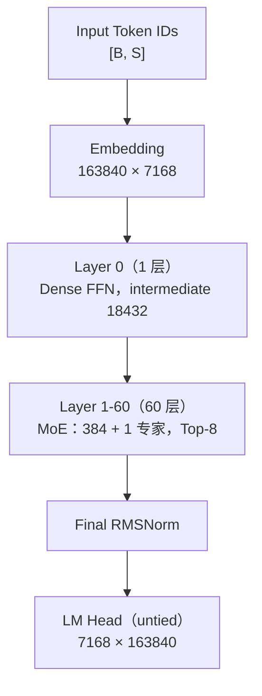
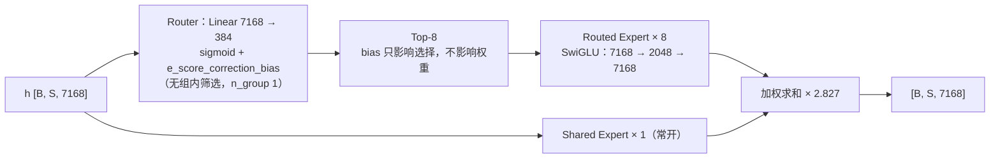

# Kimi-K2

`Kimi-K2 系列 · MoE · MLA · 1T 总参数 / 32B 激活 · 2025-07 发布`

万亿参数 MoE：直接采用 **DeepSeek-V3 代码库**（config 的 `architectures` 就是 `DeepseekV3ForCausalLM`），MLA 维度与 V3 完全一致；差异集中在专家规模（384 个路由专家）、首层 Dense 数（1 层）、路由缩放与词表，训练侧则以 **MuonClip** 优化器解决大规模训练中 attention logits 溢出问题（15.5T tokens，模型卡）。

## 规格总览

以下数值除注明外均取自 [HF config.json](https://huggingface.co/moonshotai/Kimi-K2-Instruct/raw/main/config.json)（本地快照 `data/models/raw/kimi-k2.json`）。

| 项 | 值 | 与 DeepSeek-V3 对比 |
| --- | --- | --- |
| 模型类 | `DeepseekV3ForCausalLM`（`model_type: kimi_k2`） | 相同代码库 |
| 总参数 / 激活参数 | 1T / 32B（模型卡） | 671B / 37B |
| 层数 | 61（`first_k_dense_replace = 1`） | 前 3 层 Dense → 仅 1 层 |
| Hidden Size | 7168 | 相同 |
| Attention | MLA：`q_lora_rank 1536`，`kv_lora_rank 512`，nope 128 / rope 64 / v 128，Q Heads **64** | 头数减半（128 → 64） |
| RoPE | `theta = 5e4`，YaRN ×32（4096 → 131072） | theta 1e4 / YaRN ×40 |
| MoE | **384** 路由专家 + 1 共享，Top-8，moe_intermediate 2048 | 256 + 1 |
| Router | sigmoid + `noaux_tc` + bias，`n_group 1`（无组内筛选），`routed_scaling_factor 2.827` | V3 有 8 组选 4 的组内筛选，scale 2.5 |
| MTP | `num_nextn_predict_layers = 0`（未随权重发布 MTP 模块） | V3 为 1 |
| 词表 | 163840 | 129280 |
| 权重精度 / 体积 | 主仓原生 **FP8**（blockwise 128×128）· **1029.2 GB**（safetensors 实测总和，`data/models/weight_sizes.json`，下同） | V3 主仓同为 FP8（688.6 GB） |
| KV Cache 精度 | 默认 **BF16**（latent 576 → 68.6 KiB/token，与 V3 同）；官方无量化 KV 配置，FP8 latent KV 属框架侧能力 | 相同 |

## 整体结构

结构图与 [DeepSeek-V3](/deepseek/deepseek-v3/) 相同，仅两处不同：Dense FFN 层从 3 层减为 1 层；MoE 层的专家池扩大到 384。

## Attention：MLA（与 V3 同构）

计算路径与 KV Cache 吸收逻辑见 [DeepSeek-V3 页](/deepseek/deepseek-v3/)。K2 的差异：

- Q heads 从 128 减到 64，`q_b` 输出 64×192 = 12288 维；KV Cache 同样只存 `(512 + 64) = 576` 元素/层/token，61 层合计 **≈ 68.6 KiB/token**（BF16）。
- rope_theta 提高到 5e4，配合 YaRN ×32 达到 131072 上下文。

## MoE：384 专家

- **激活参数估算**：MoE ≈ 60 × (8+1) × 3 × 7168×2048 + 1 层 Dense 0.4B ≈ 24.2B；Attention ≈ 61 × 101M ≈ 6.2B；Embedding + Head ≈ 2.35B；合计 ≈ **32.7B**，与官方 32B 一致。
- 训练侧的关键创新是 **MuonClip**：Muon 优化器 + 对 attention 模块权重更新做裁剪，在万亿参数规模上稳定 attention logits（模型卡）。

## 演进

| 模型 | 时间 | 说明 |
| --- | --- | --- |
| Kimi-K2-Base / Instruct | 2025-07 | 万亿 MoE + MLA，agentic 训练 |
| Kimi-K2-Thinking | 2025-11 | 推理增强版，iterative RL |
| Kimi-Linear-48B-A3B | 2025-10 | **混合线性注意力**路线（Hybrid LINear attention） |
| Kimi-K2.5 / K2.6 / K3 | 2026-01 / 04 / 06 | 后续迭代（本页暂不展开） |

## 原始资料

- [Hugging Face 模型仓库](https://huggingface.co/moonshotai/Kimi-K2-Instruct)（config.json / 模型卡）
- [Kimi K2 技术报告（arXiv:2507.20534）](https://arxiv.org/abs/2507.20534)
- 本地 config 快照：`data/models/raw/kimi-k2.json`
