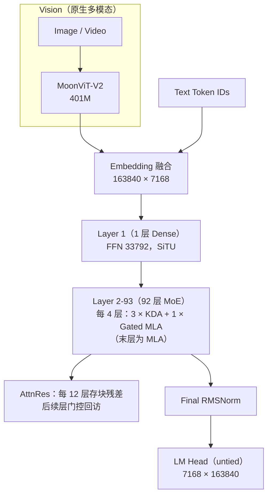
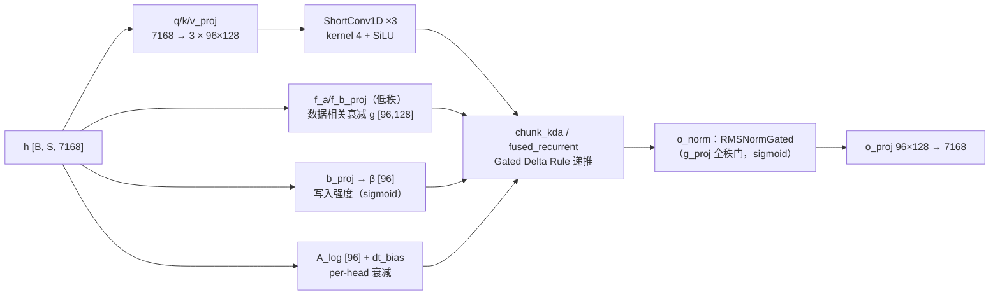
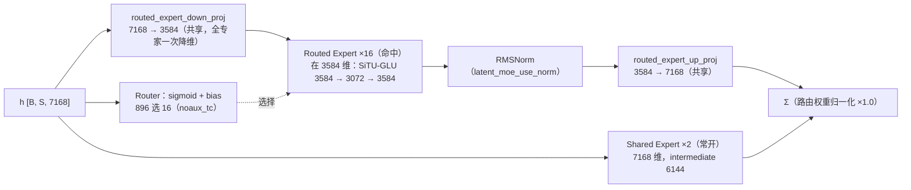

# Kimi-K3

`Kimi-K3 系列 · 混合线性注意力 MoE · 2.8T 总参数 / 104B 激活 · 2026-06 发布 · 原生多模态 · MXFP4`

Kimi-Linear 混合架构直接登上旗舰：**69 层 KDA（Kimi Delta Attention，Gated DeltaNet 家族）+ 24 层 Gated MLA**，配四项新机制——**AttnRes（块级残差回访）**、**LatentMoE（路由专家在 3584 维 latent 空间工作）**、**SiTU 有界激活**、**原生 MXFP4 量化训练**。开源权重中首个 3T 级模型，1M 上下文，标称整体 scaling 效率较 K2 提升约 2.5×（模型卡）。代码库从 K2 的 `DeepseekV3ForCausalLM` 换成自有 `KimiLinearForCausalLM`（HF 仓库 remote code，`modeling_kimi_linear.py`）。

## 规格总览

数值除注明外取自 [HF config.json](https://huggingface.co/moonshotai/Kimi-K3/raw/main/config.json)（本地快照 `data/models/raw/kimi-k3.json`）与 [remote code](https://huggingface.co/moonshotai/Kimi-K3/blob/main/modeling_kimi_linear.py)。

| 项 | 值 |
| --- | --- |
| 模型类 | `KimiK3ForConditionalGeneration`（text：`KimiLinearForCausalLM`，`model_type: kimi_linear`） |
| 总参数 / 激活参数 | 2.8T / 104B（模型卡） |
| 层数 | 93（`first_k_dense_replace = 1`，首层 Dense FFN 33792） |
| Attention 排布 | **24 层 Gated MLA + 69 层 KDA**（`full_attn_layers` = 4, 8, …, 92, 93，1-based；每 4 层 1 层 full + 末层 full） |
| Hidden Size | 7168 |
| Gated MLA | `q_lora_rank 1536`，`kv_lora_rank 512`，nope 128 / rope 64 / v 128，Q Heads **96**；输出门 `g_proj`（sigmoid） |
| KDA | 96 heads × head_dim 128，ShortConv kernel 4，full-rank 数据相关门，`gate_lower_bound −5.0` |
| MoE | **896 路由专家 Top-16 + 2 共享专家**；路由专家 hidden **3584**（LatentMoE），`moe_intermediate_size 3072` |
| Router | sigmoid + `noaux_tc`（e_score_correction_bias），`n_group 1`（无组筛选），归一化后 ×1.0 |
| 激活函数 | **SiTU**（`β 4.0`，`linear_β 25.0`，fp32 计算） |
| 残差 | 标准 + **AttnRes**（`attn_res_block_size 12`，块级残差回访） |
| MTP | `num_nextn_predict_layers = 0`（未配 MTP） |
| 上下文 | 1,048,576（1M） |
| 多模态 | 原生：MoonViT-V2 视觉编码器 401M（模型卡） |
| 词表 | 163,840（tiktoken 分词） |
| 权重精度 / 体积 | 原生 **MXFP4 权重 + MXFP8 激活**（group 32，QAT，从 SFT 阶段起）· **1560.9 GB**（仓库 safetensors 实测总和，`data/models/weight_sizes.json`，下同）；[Kimi-K3-BF16](https://huggingface.co/moonshotai/Kimi-K3-BF16) 为受限仓库（需申请授权，体积未测） |
| KV Cache 精度 | 默认 **BF16**（Gated MLA 不做权重吸收，展开式 cache **1.41 MiB/token** + KDA 固定 state 221.6 MiB/序列，见 Attention 节）；1M 上下文单序列累计 ~1.4 TiB，实际部署依赖 KV 量化与 P/D 分离（见部署节） |
| License | Kimi K3 License（非标准开源协议） |

## 整体结构

- **AttnRes（Attention Residuals）**：把 93 层按 `attn_res_block_size = 12` 分块。每层的主残差路径不变，但额外维护跨块传递的 `block_residual` 列表；每层的 attention 与 FFN 输出会经过一次「块粒度极简 attention」——以 token 内容为 query（`res_proj`：hidden→1 的标量打分 + RMSNorm 权重），对「所有历史块残差 + 当前块内直通」做 softmax 加权回访（remote code `_apply_attn_res`）。每 12 层把当前累积态存为新块。代价仅两个 7168→1 投影/层，收益是深层可以低开销重访早期层信息。

## Attention：KDA 与 Gated MLA 混排

### 层排布与取舍

24 层 softmax（Gated MLA）承担全局检索与精确回看；69 层线性（KDA）以固定大小 state 递推，把长上下文的 cache 增长与计算从 O(S) 压到 O(1)/token。这与 Qwen3.5/3.8（3:1 混排）同思路，但 Kimi 的 full 层用 MLA 投影、线性层用自有 KDA。

### KDA（Kimi Delta Attention）

- 与标准 Gated DeltaNet 的差异（remote code `KimiDeltaAttention`）：**full-rank 门**（`g_proj` 直接 7168→96×128，而非低秩两段）；**`gate_lower_bound −5.0`**（kernel 内 clamp 门控下界，防状态被过度冲刷）；q/k 在 kernel 内做 L2 norm；v 侧 ShortConv SiLU。
- **State cache（固定，不随序列增长）**：`recurrent_state [B, 96, 128, 128]` = 1.57M 元素/层 + ShortConv 状态 `3 × 3 × 12288` = 0.11M 元素/层。69 层合计 ≈ **221.6 MiB/序列（BF16）**。
- 解码路径 `fused_recurrent`，prefill 路径 `chunk_kda`（remote code 内置双模式）。

### Gated MLA（24 层 full）

投影结构与 DeepSeek-V3 同源（`q_a/q_b` 低秩 Q + `kv_a/kv_b` latent KV），两点关键差异：

1. **不做权重吸收，cache 存 per-head 展开结果**：`kv_b_proj` 把 latent 直接升维成 96 heads 的完整 K/V，cache 写入 `K [96, S, 192]`（nope 128 + rope 64）与 `V [96, S, 128]`——即 **30,720 元素/token/层**，是 MHA 式展开而非 V3 的 latent 576。换取的是实现简单（标准 attention kernel 可用，无需吸收式 FlashMLA 路径）。
2. **输出门控**：`g_proj(x).sigmoid()` 逐元素乘在 attention 输出上（`mla_use_output_gate`），再过 `o_proj`——与 Hunyuan Hy4 的 gated MLA 思想一致（该门在 Hy4 为 fp32 elementwise；K3 为 hidden 直投 sigmoid）。

### KV Cache 核算（BF16）

| 组成 | 大小 | 随序列增长 |
| --- | --- | --- |
| 24 层 Gated MLA（展开式） | 96×(192+128)×24 = 737,280 元素/token ≈ **1.41 MiB/token** | 线性 |
| 69 层 KDA state | 1.68M 元素/层 ≈ **221.6 MiB/序列** | 否（固定） |

每 token 等效 = 737,280 + 116M/S（S 为序列长）。KDA 摊薄极快（S=4K 时占 28%、32K 时 0.5%）。对照 [Kimi-K2](/kimi/kimi-k2/)（61 层全 MLA latent 576）：**68.6 KiB/token → 1.41 MiB/token（≈21×）**——K3 用 69 层零增长 state 换掉了大部分 cache，但保留的 24 层 full 走展开式 cache，每 token 成本显著高于 K2 的 latent 式；1M ctx 单序列 BF16 累计可达 ~1.4 TiB，实际部署依赖 KV 量化与 P/D 分离（见部署节）。

## MoE：LatentMoE（896 专家 Top-16）

- **LatentMoE**：896 个路由专家不在 7168 维 hidden 空间工作，而是经一对共享投影进入 **3584 维 latent 空间**（`routed_expert_hidden_size 3584`），专家 FFN 为 3584→3072→3584，输出过 RMSNorm（`latent_moe_use_norm`）再升回 7168。每专家参数 3×3584×3072 ≈ 33M，比 7168 维空间省一半；92 个 MoE 层的路由专家合计 ≈ 2.72T。这就是「Stable LatentMoE」的主体（稳定 = latent 空间 norm + SiTU 有界激活）。
- **路由**：DeepSeek-V3 学派 sigmoid + `e_score_correction_bias`（只影响选择不影响权重）+ Top-16 归一化，`routed_scaling_factor 1.0`（无放大）。896 选 16 的稀疏度（1.8%）配合双共享专家。
- **激活参数估算**：MoE ≈ 92 × (16×33.0M + shared 132M + 升降维 51M) ≈ 69.8B；KDA ≈ 69 × 444M ≈ 30.6B；MLA ≈ 24 × 242M ≈ 5.8B；Dense 首层 0.73B；Embedding+Head ≈ 2.35B；合计 ≈ **105B**，与模型卡 104B 一致。
- **SiTU 激活**（`SituAndMul`）：`act = β·tanh(gate/β)·sigmoid(gate)`，`β=4.0`；up 分支同样有界化 `25·tanh(up/25)`，fp32 计算。tanh 双侧裁剪抑制专家输出爆炸——top-16 求和路径下的稳定性手段。

## 原生 MXFP4 量化与部署

- **MXFP4 权重 + MXFP8 激活**（group 32，OCP MX 格式，targets 全部 Linear），**QAT 从 SFT 阶段开始**——不是训练后量化，权重即 4-bit 发布（96 个 safetensors 分片，实测 1560.9 GB，`data/models/weight_sizes.json`）。
- 官方部署口径（vLLM recipe）：**至少 8× GB300**（CUDA，多机用于生产流量）或 8× MI355X/MI350X（ROCm）；参考拓扑 TP8、EP16、TP8×PP2 与 disaggregated P/D；MoE 后端建议 `deep_gemm_mega_moe`（GB200/GB300 NVLink 跨节点，不兼容跨节点 RDMA）。
- 推理行为：thinking 常开（`reasoning_content`），`reasoning_effort` low/high/max 三档（默认 max）；多轮需原样回传含 `reasoning_content` 的完整 assistant 消息（preserved thinking history）。

## 与 Kimi-K2 对比

| 维度 | Kimi-K2（2025-07） | Kimi-K3（2026-06） |
| --- | --- | --- |
| 代码库 | `DeepseekV3ForCausalLM`（复用 V3） | `KimiLinearForCausalLM`（自有） |
| 总参 / 激活 | 1T / 32B | 2.8T / 104B |
| 层数（Dense 首层） | 61（1） | 93（1） |
| Attention | 61 层 MLA（latent 576，吸收式） | 69 KDA + 24 Gated MLA（展开式 320/head） |
| Q Heads / q_lora | 64 / 1536 | 96 / 1536 |
| KV Cache | 68.6 KiB/token | 1.41 MiB/token（MLA 部分）+ 固定 222 MiB/序列（KDA） |
| MoE | 384+1，Top-8，scale 2.827 | 896+2，Top-16，scale 1.0，LatentMoE 3584 |
| 激活 | SwiGLU | SiTU（有界，fp32） |
| 残差 | 标准 | 标准 + AttnRes（12 层/块） |
| 上下文 | 128K（YaRN） | 1M |
| 多模态 | 无 | 原生（MoonViT-V2 401M） |
| 精度 | FP8 blockwise 128×128 | MXFP4 权重 + MXFP8 激活（QAT） |
| MTP | 0 | 0 |

## 演进

| 模型 | 时间 | 说明 |
| --- | --- | --- |
| Kimi-K2-Base / Instruct | 2025-07 | 万亿 MoE + MLA（V3 代码库），MuonClip |
| Kimi-K2-Thinking | 2025-11 | 推理增强，iterative RL |
| Kimi-Linear-48B-A3B | 2025-10 | **混合线性注意力试验田**（KDA 前身） |
| Kimi-K2.5 / K2.6 / K2.7-Code | 2026-01 / 04 / 06 | K2 架构迭代（K2.7-Code 为代码特化） |
| **Kimi-K3** | **2026-06** | **KDA 上旗舰：2.8T/104B，AttnRes + LatentMoE + SiTU + MXFP4，1M ctx，原生多模态** |

## 原始资料

- [Hugging Face 模型仓库](https://huggingface.co/moonshotai/Kimi-K3)（config.json / README / remote code）
- [Kimi-K3 技术报告（GitHub MoonshotAI/Kimi-K3）](https://github.com/MoonshotAI/Kimi-K3/blob/main/k3_tech_report.pdf)
- [技术博客](https://www.kimi.com/blog/kimi-k3)
- [vLLM 部署 recipe](https://recipes.vllm.ai/moonshotai/Kimi-K3)
- 本地 config 快照：`data/models/raw/kimi-k3.json`；建模源码：HF 仓库 `modeling_kimi_linear.py`
