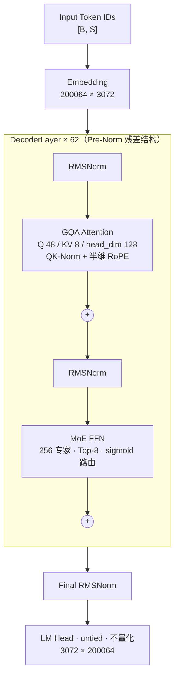
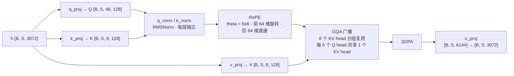
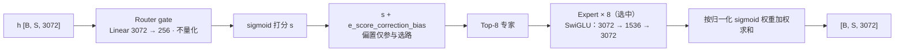

# MiniMax-M2

`MiniMax 家族 · MoE · GQA · 230B 总参数 / 10B 激活 · 2025-10 发布`

MiniMax 面向 coding / agentic 工作流的轻量旗舰：62 层 Decoder、每层 GQA + 细粒度 MoE（256 选 8、无共享专家），以约 10B 激活参数冲击远大于自身的模型。相对前代最重要的结构变化是**彻底放弃 Lightning Attention 混合层，62 层全部回到 softmax Full Attention**，路由换成 DeepSeek-V3 式 sigmoid + 偏置，并以原生 FP8 权重发布。interleaved thinking 模型，推理时需把历史消息中的思考内容原样回传。

## 规格总览

以下数值除注明外均取自 [HF config.json](https://huggingface.co/MiniMaxAI/MiniMax-M2/raw/main/config.json)（本地快照 `data/models/raw/minimax-m2.json`）。

| 项 | 值 |
| --- | --- |
| 模型类 | `MiniMaxM2ForCausalLM`（`model_type: minimax_m2`，仓库自带 auto_map 实现） |
| 总参数 / 激活参数 | 230B / 10B（官方模型卡） |
| 发布时间 | 2025-10（HF 仓库创建于 2025-10-22） |
| 层数 | 62；62 层全部为 MoE 层，无 Dense 前置层 |
| Hidden Size | 3072 |
| Attention | GQA：Q Heads 48，KV Heads 8，Head Dim 128，全部层 softmax Full Attention |
| RoPE | `theta = 5e6`，`rotary_dim = 64`（head_dim 128 中仅前 64 维旋转），无 rope_scaling；原生 `max_position_embeddings = 196608`（192k） |
| QK Norm | 有（`use_qk_norm: true`，`qk_norm_type: per_layer`，每层独立的 q/k RMSNorm） |
| FFN | MoE：256 专家，Top-8，专家维度 `intermediate_size = 1536`，无共享专家（`shared_intermediate_size = 0`） |
| Router | `scoring_func: sigmoid` + `e_score_correction_bias` 偏置选路（`use_routing_bias: true`），Top-8 权重归一化——DeepSeek-V3 式 |
| MTP | `use_mtp: true`：训练侧在 62 层后追加 3 个单层 MTP 模块（`num_mtp_modules = 3`，`mtp_transformer_layers = 1`）；公开权重未包含这些层 |
| 量化 | 原生 FP8（e4m3，128×128 block，dynamic activation scheme）；gate / e_score_correction_bias / lm_head 不量化 |
| 权重精度 / 体积 | 主仓原生 **FP8** · **230.1 GB**；BF16 版为 gated 仓库（[MiniMax-M2-BF16](https://huggingface.co/MiniMaxAI/MiniMax-M2-BF16)，需申请）。体积为 safetensors 实测总和（`data/models/weight_sizes.json`，下同） |
| KV Cache 精度 | 默认 **BF16**（248 KiB/token：8 KV × 128 × 62 层 × 2 × 2B）；官方无量化 KV 配置，FP8 KV 属框架侧通用能力 |
| 词表 / LM Head | vocab 200064，`tie_word_embeddings = false` |
| Norm | RMSNorm，eps 1e-6，Pre-Norm（前代 Text-01 / M1 的 post-norm + alpha 残差缩放已移除） |
| 采样建议 | temperature 1.0 / top_p 0.95 / top_k 40（官方模型卡） |

## 整体结构

config 中有两个**不被任何官方实现读取的遗留字段**（HF / vLLM / SGLang 源码均无引用）：

- `attn_type_list`：68 项、全部为 1。在前代 [MiniMax-Text-01](https://huggingface.co/MiniMaxAI/MiniMax-Text-01) / M1 中该字段按层编码注意力类型（源码判定 `0` → softmax Full Attention，`1` → Lightning Attention，80 项中 70 个 0 / 10 个 1，即每 8 层 1 层线性注意力的 7:1 混合）。M2 的 HF / vLLM / SGLang 实现里只有一个标准 GQA softmax attention 类，**不存在任何 Lightning Attention 代码**，因此 M2 已完全放弃线性注意力混合设计。68 与 62 的差值没有官方解释（后续 M2.1 / M2.5 的 config 已将该列表修正为与层数一致的 62 项，说明它只是元数据）。
- `mlp_intermediate_size = 8192`：无实现读取。真正生效的专家 FFN 维度是 `intermediate_size = 1536`（HF 代码中 `MiniMaxM2MLP.ffn_dim = config.intermediate_size`）；`mlp_intermediate_size` 应对应一条未启用的 Dense MLP 路径。

## Attention：全 softmax GQA

要点：

- **投影形状**：`q_proj 3072×6144`，`k_proj / v_proj 3072×1024`，`o_proj 6144×3072`，均无 bias；`scaling = head_dim^-0.5`。
- **QK-Norm**：对投影后的 Q（拼接后 6144 维）与 K（1024 维）整体做 RMSNorm，再过 RoPE；权重名为 `layers.N.self_attn.q_norm.weight` / `k_norm.weight`，每层独立（`qk_norm_type: per_layer`）。
- **半维 RoPE**：`rotary_dim = 64`、head_dim 128，即 `partial_rotary_factor = 0.5`——每个 head 仅前 64 维旋转，后 64 维直通；`theta` 从前代的 1e7 降到 5e6。同款半维旋转在 Text-01 / M1 上已使用。
- **KV Cache（BF16）**：每 token 为 `2 × 62 层 × 8 KV head × 128 维 × 2B = 248 KiB`；100 万 token 约 248 GB。KV 头从 8 个起步（前代同），但层数 80→62，总 KV Cache 约为 M1 的 77%。
- 家族注意力演进（softmax ↔ 线性注意力的取舍）见 [Attention 变体总览](/guide/attention/)；M2 是「先混合、后放弃」路线的落地样本。

## MoE：细粒度专家 + sigmoid 路由

要点：

- **DeepSeek-V3 式路由**：sigmoid 打分后，`e_score_correction_bias` 只加在选路分数上决定 Top-8，最终权重取选中专家的 sigmoid 分数并归一化（`renormalize`）。这与 [DeepSeek-V3](https://huggingface.co/deepseek-ai/DeepSeek-V3) 的无辅助损失负载均衡一致；前代 Text-01 / M1 用的是 Mixtral 式 softmax + aux loss 路由（config 里的 `router_aux_loss_coef = 0.001` 是遗留字段）。路由背景见 [MoE 总览](/guide/moe/)。
- **无共享专家**：每层 256 个路由专家激活 8 个（`shared_intermediate_size = 0`，checkpoint 中无 shared 权重），与 [Qwen3-30B-A3B](/qwen/qwen3-30b-a3b/) 同为「细粒度专家 + 无共享专家」路线；对比前代 32 选 2，颗粒度大幅变细。
- **激活参数构成估算**（仅计矩阵参数）：
  - Attention：`62 × (6144×3072×2 + 1024×3072×2) ≈ 2.73B`
  - Router gate：`62 × 3072×256 ≈ 0.05B`
  - MoE 专家：`62 × 8 × 3 × 3072×1536 ≈ 7.02B`
  - 合计 ≈ **9.8B**（不含 embedding / lm_head），与官方 10B 口径一致。
  - 总参数校验：`62 × (256×3×3072×1536 + attn) + embed/lm_head ≈ 229B`，官方口径 230B。
- **FP8**：全部权重 blockwise FP8（`weight_block_size = [128, 128]`，每张量附 `weight_scale_inv`），激活 dynamic scheme；router gate、`e_score_correction_bias`、lm_head 保持高精度不量化。
- **MTP 权重未发布**：训练侧完整权重在 62 层主干后还有 3 个 MTP 模块（vLLM / SGLang 加载时按 `layers.62–64` 显式丢弃），但公开的 safetensors 索引（96,103 个张量）只含 layers 0–61——即 M2 公开权重无 MTP 投机解码可用，MTP 仅用于训练加速 / 后续变体。

## 演进

| 对比对象 | 主要差异 |
| --- | --- |
| MiniMax-Text-01（2025-01） | 456B A45.9B，80 层、hidden 6144、Q64/KV8；softmax 与 Lightning Attention **7:1 混合**（每 8 层 1 层线性）；32 专家 Top-2、softmax 路由 + aux loss；post-norm（残差乘 `alpha ≈ 3.5565`）；`theta = 1e7`；HF 发布为 BF16 |
| MiniMax-M1（2025-06） | 与 Text-01 完全同构（config 仅 `model_type` / auto_map 不同），保留 Lightning Attention 混合层，原生 1M 上下文，提供 40k / 80k 两个权重变体 |
| **MiniMax-M2（本页，2025-10）** | 230B A10B：注意力全部收敛为 GQA softmax（放弃 Lightning 混合）；62 层、hidden 3072、Q48/KV8；MoE 32 选 2 → **256 选 8**；路由换为 sigmoid + 偏置；新增 per-layer QK-Norm、回归 pre-norm；原生 FP8 发布 |
| M2.1 / M2.5 / M2.7（2025-12 → 2026-04） | 同构迭代版，config 与 M2 基本一致（M2.7 `max_position_embeddings` 提至 204800）；模型卡见 [HF MiniMaxAI](https://huggingface.co/MiniMaxAI) |
| M3 / H3 / M3.1-Flash（2026 年中后） | 新一代 `MiniMaxM3Sparse` 架构（M3 2026-06、H3 2026-07、M3.1-Flash 2026-10，mxfp8 量化），站内暂无页面 |

## 原始资料

- [Hugging Face 模型仓库](https://huggingface.co/MiniMaxAI/MiniMax-M2)（模型卡 / config.json / safetensors 索引）
- [configuration_minimax_m2.py](https://huggingface.co/MiniMaxAI/MiniMax-M2/raw/main/configuration_minimax_m2.py) / [modeling_minimax_m2.py](https://huggingface.co/MiniMaxAI/MiniMax-M2/raw/main/modeling_minimax_m2.py)
- [vLLM 实现 minimax_m2.py](https://github.com/vllm-project/vllm/blob/main/vllm/model_executor/models/minimax_m2.py)（MTP 层丢弃逻辑 / FusedMoE 路由）
- [MiniMax-Text-01 config.json](https://huggingface.co/MiniMaxAI/MiniMax-Text-01/raw/main/config.json) / [MiniMax-M1-80k config.json](https://huggingface.co/MiniMaxAI/MiniMax-M1-80k/raw/main/config.json)
- [MiniMax-M1 GitHub](https://github.com/MiniMax-AI/MiniMax-M1)（456B / 45.9B、1M 上下文口径）
- 本地 config 快照：`data/models/raw/minimax-m2.json`
