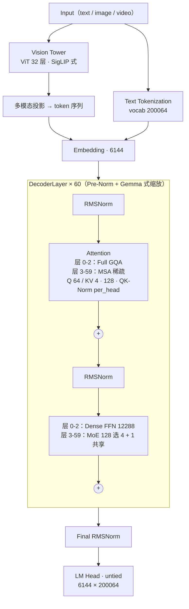
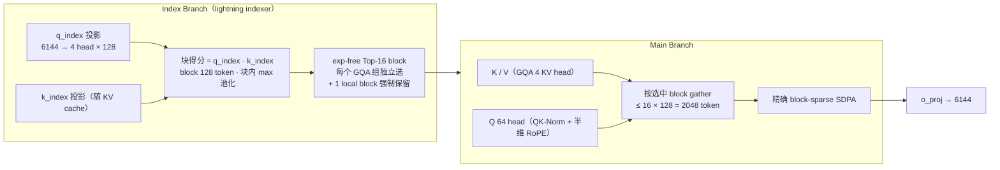
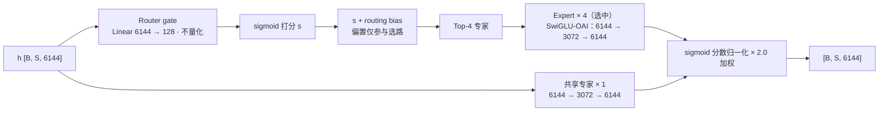

# MiniMax-M3

`MiniMax 家族 · MoE · GQA + MSA 稀疏注意力 · 428B 总参数 / 23B 激活 · 原生多模态 · 1M 上下文 · 2026-06 发布`

MiniMax 面向 coding / agentic / 计算机使用的旗舰：60 层 Decoder，GQA 骨架之上引入 **MSA（MiniMax Sparse Attention）**——轻量 indexer 按 KV block 打分、每个 GQA 组独立选 Top-16 block，注意力只在约 2048 个 token 上精确计算，把 1M 上下文的每 token 计算降到 GQA 的约 1/20（官方口径：vs M2 prefill 9× / decode 15× 加速）。MoE 从 M2 的 256 选 8 无共享改为 **128 选 4 + 1 共享专家**，原生多模态（text / image / video 第一步起混合训练），上下文从 192k 直接拉到 1M。`thinking` 参数三档可调（enabled / adaptive / disabled）。

## 规格总览

以下数值除注明外均取自 [HF config.json](https://huggingface.co/MiniMaxAI/MiniMax-M3/raw/main/config.json)（本地快照 `data/models/raw/minimax-m3.json`，`text_config` 嵌套于 `MiniMaxM3SparseForConditionalGeneration` 多模态 wrapper）。

| 项 | 值 |
| --- | --- |
| 模型类 | `MiniMaxM3SparseForConditionalGeneration`（`model_type: minimax_m3_vl`，权重前缀 `language_model.model.*` + `vision_tower.*`） |
| 总参数 / 激活参数 | 428B / 23B（官方模型卡；矩阵参数核算 ≈426B / ≈23B，见下文） |
| 发布时间 | 2026-06（HF 仓库创建于 2026-06-02）；BF16 权重共 59 个 safetensors（实测合计 854.2 GB） |
| 层数 | 60；前 3 层 Dense FFN，后 57 层 MoE（`moe_layer_freq: [0,0,0,1×57]`） |
| Hidden Size | 6144 |
| Attention | GQA：Q 64 / KV 4，Head Dim 128；**层 3–59 为 MSA 稀疏注意力，层 0–2 为 Full Attention**（`sparse_attention_freq: [0,0,0,1×57]`） |
| MSA Indexer | index head 4（对应 4 个 KV 组）× dim 128；block 128 token，Top-16 block + 1 local block；块得分取 block 内 max（`sparse_score_type: max`） |
| RoPE | `theta = 5e6`，`rotary_dim = 64`（head_dim 128 的前 64 维旋转，`partial_rotary_factor = 0.5`）；无 rope_scaling，原生 `max_position_embeddings = 1048576`（1M） |
| QK Norm | 有（`use_qk_norm: true`，`qk_norm_type: per_head`——比 M2 的 per_layer 更细） |
| FFN | MoE：128 路由专家 Top-4 + 1 共享专家；专家维度 `intermediate_size = 3072`，共享专家 `shared_intermediate_size = 3072`，Dense 层 `dense_intermediate_size = 12288`；权重模块名 `block_sparse_moe` |
| Router | `scoring_func: sigmoid` + `use_routing_bias: true` 偏置选路，`routed_scaling_factor = 2.0`——延续 M2 的 DeepSeek-V3 式路由 |
| 激活函数 | SwiGLU-OAI（`hidden_act: swigluoai`）：sigmoid 增益 `swiglu_alpha = 1.702`，gate / up 投影 ±7 限幅（`swiglu_limit = 7.0`） |
| Norm | `use_gemma_norm: true`（Gemma 式缩放，见下文），eps 1e-6 |
| MTP | 训练侧 7 个 EAGLE-like MTP 模块（`num_mtp_modules = 7`，`num_nextn_predict_layers = 1`）；**公开权重不含**（safetensors 索引只有 layers 0–59，无 mtp/nextn 张量） |
| 权重精度 / 体积 | 主仓 BF16 · **854.2 GB**；官方 MXFP8 量化版 443.7 GB（[MiniMax-M3-MXFP8](https://huggingface.co/MiniMaxAI/MiniMax-M3-MXFP8)）。体积为仓库 safetensors 实测总和（`data/models/weight_sizes.json`，下同） |
| KV Cache 精度 | 默认 **BF16**（GQA 120 KiB/token，见 Attention 节；indexer k_index 若随存另加，官方 decode kernel 按 paged FP8 设计——待核实）；官方无量化 KV 权重配置 |
| 词表 / LM Head | vocab 200064，`tie_word_embeddings = false` |
| 采样建议 | temperature 1.0 / top_p 0.95（官方模型卡） |
| License | minimax-community |

## 整体结构

## Attention：GQA + MSA 稀疏注意力

MSA（[arXiv:2606.13392](https://arxiv.org/abs/2606.13392)）是**建立在 GQA 之上的 blockwise 稀疏注意力**：不改 KV Cache 布局，改「参与计算的 block 集合」。双分支：

要点：

- **per-GQA-group 检索**：64 个 Q head 按 4 个 KV 组分组，indexer 的 4 个 index head（各 128 维）**每个组独立**选自己的 Top-16 block——同一层不同 KV 组看到的 token 子集不同（DeepSeek DSA 的 indexer 是全层共享一套头，Hy4 用 IndexCache 每 5 层复用，MSA 是第三种切法：按 KV 组切）。
- **block 粒度**：block = 128 token，Top-16 block → 参与计算的 token 上限 2048；另强制保留 1 个 local block（`index_local_blocks = 1`）保证邻域。块得分取 block 内 index 点积的 max（`sparse_score_type: max`），选择过程 **exp-free**、attention 为 **KV-outer** 布局，均为 tensor-core 利用率优化的设计（论文口径）。
- **层分布**：层 0–2 Full Attention、层 3–59 稀疏（M3）；M3.1-Flash 起全 60 层稀疏。
- **投影形状**（Dense 等价口径）：`q_proj 6144×8192`，`k_proj / v_proj 6144×512`，`o_proj 8192×6144`；QK-Norm 为 per_head（每 head 独立 RMSNorm，比 M2 的 per_layer 整体 norm 更细）。
- **KV Cache（BF16）**：`2 × 60 层 × 4 KV head × 128 × 2B = 120 KiB/token`，约为 [M2](/minimax/minimax-m2/)（248 KiB）的一半；1M token ≈ 114 GB。若 indexer 的 k_index（4 head × 128 维 × 57 个稀疏层）也随 cache 保存，另增 ≈57 KiB/token（BF16，FP8 约 28 KiB——官方 kernel 的 decode 路径按 paged FP8 设计，实际口径以 MSA kernel 文档为准，**待核实**）。
- **kernel**：官方开源 [MiniMax-AI/MSA](https://github.com/MiniMax-AI/MSA)（MIT），NVIDIA SM100 专用：CuTe-DSL 栈支持 BF16 / FP8 / NVFP4 / FP4 与 paged FP8 decode，csrc 栈提供 `sparse_topk_select` indexer。
- 官方效率口径：vs M2 @1M 上下文 **prefill 9× / decode 15×，每 token 计算降至 1/20**（M3 模型卡）；论文在 109B 实验模型上测得每 token 注意力计算降低 28.4×，H800 上 prefill 14.2× / decode 7.6×。

## MoE：128 选 4 + 共享专家回归

要点：

- **路由延续 M2 的 DeepSeek-V3 式方案**（sigmoid + 偏置 + 归一化，`routed_scaling_factor = 2.0`），见 [MoE 总览](/guide/moe/)。
- **专家颗粒度反转**：M2 是 256 选 8、无共享、专家维度 1536；M3 改为 **128 选 4 + 1 共享**、专家维度 3072——选更少、更宽的专家，并让共享专家承接公共计算（Qwen3 / DeepSeek-V3 同款「细粒度 + 共享」组合，方向上与 M2 的「纯细粒度」相反）。
- **激活参数估算**（仅计矩阵参数）：
  - Attention：`60 × (6144×8192×2 + 6144×512×2) ≈ 6.4B`（indexer 投影未计）
  - Dense FFN：`3 × 3 × 6144×12288 ≈ 0.7B`
  - MoE 路由专家：`57 × 4 × 3 × 6144×3072 ≈ 12.9B`
  - 共享专家：`57 × 3 × 6144×3072 ≈ 3.2B`
  - 合计 ≈ **23.3B**，与官方 23B 一致。
- **总参数校验**：`57 × 128 × 3 × 6144×3072 ≈ 413B` 路由专家 + 注意力 / 共享 / Dense / embedding（2 × 200064×6144 ≈ 2.5B，untied）≈ **426B**，官方口径 428B。

## 激活与归一化：SwiGLU-OAI 限幅

M3 的 token 级非线性有两处非常规设计（语义取自 transformers `MiniMaxM3VLTextConfig` docstring）：

- **SwiGLU-OAI**（`hidden_act: swigluoai`）：SwiGLU 的门控 sigmoid 增益 `swiglu_alpha = 1.702` 可调，且 **gate / up 投影输出 clamp 到 ±7**（`swiglu_limit = 7.0`）。限幅激活是大宽度 MoE 专家常见的数值稳定手段（gpt-oss 系同风格）；transformers 实现中 checkpoint 的 `swigluoai` 被归一化为 `silu` fallback + 内联 gate 计算。
- **Gemma 式 Norm**（`use_gemma_norm: true`）：Gemma 系的 norm 做法是 RMSNorm 输出乘 `(1 + weight)`（零中心化缩放），eps 1e-6。具体实现文件尚未进入 transformers main（仅 configuration 在库），**公式口径待核实**。

## MTP：训练侧 7 模块，权重不发布

与 M2 同款策略：`num_mtp_modules = 7`、`num_nextn_predict_layers = 1`，训练时在 60 层主干后挂 EAGLE-like MTP 模块加速训练；但公开的 safetensors 索引（权重张量共 `language_model.model.layers.0–59` + vision tower + lm_head）**不含任何 mtp / nextn / draft 张量**——M3 公开权重无 MTP 投机解码可用。M3.1-Flash 起改为发布 **DSpark draft head**（见下文）。

## 演进

| 对比对象 | 主要差异 |
| --- | --- |
| [MiniMax-M2](/minimax/minimax-m2/)（2025-10） | 230B A10B，62 层 hidden 3072，GQA Q48/KV8 全 Full Attention，256 选 8 无共享（专家 1536），QK-Norm per_layer，`theta = 5e6`，192k 上下文，BF16 + FP8 变体 |
| **MiniMax-M3（本页，2026-06）** | 428B A23B，60 层 hidden 6144，**GQA + MSA 稀疏（Top-16 block × 128）**，128 选 4 + 1 共享（专家 3072），原生多模态，1M 上下文，SwiGLU-OAI 限幅，QK-Norm per_head |
| MiniMax-H3（2026-07） | 独立产品线（非 M 系直接迭代），站内暂无页面 |
| MiniMax-M3.1-Flash（2026-10） | 同构迭代：全 60 层稀疏 + QAT（MXFP8 原生）+ DSpark 投机解码头，见下节 |

家族注意力演进（Lightning 混合 → 全 softmax → 稀疏）见 [Attention 变体总览](/guide/attention/)；M3 是「放弃线性混合之后，用稀疏索引重新进攻长上下文」的落地样本。

## M3.1-Flash（2026-10）

[MiniMax-M3.1-Flash](https://huggingface.co/MiniMaxAI/MiniMax-M3.1-Flash)（HF 仓库 2026-10-17）：**与 M3 完全同构**（428B / 23B，60 层 6144，config 逐字段一致），官方权重即 **MXFP8 · 252.4 GB**（safetensors 实测，`data/models/weight_sizes.json`），三项推理侧升级：

- **Sparse attention throughout**：前 3 层 Full Attention 也替换为稀疏（`sparse_attention_freq` 全 1），全模型无全注意力层。
- **QAT 量化感知训练**：MXFP8 原生发布（`quant_method: mxfp8`，dynamic activation，weight block `[1, 32]`），路由 MoE 专家与 attention 路径训练中量化；**router gate 全部不量化**（ignored_layers 列出全部 57 层的 `block_sparse_moe.gate`）。
- **DSpark 投机解码**：取代 EAGLE-like MTP，draft head 随权重发布（M3.1 的 config 无 MTP 字段）。
- 其余差异：`rope_theta` 5e6 → 1e7（回到 Text-01 口径）。

官方基准将 M3.1-Flash 与 [DeepSeek V4.1 Flash-1017](/deepseek/deepseek-v4.1-flash/) 直接对标（agentic / coding / cybersecurity）。

## 原始资料

- [Hugging Face 模型仓库](https://huggingface.co/MiniMaxAI/MiniMax-M3)（模型卡 / config.json / safetensors 索引）
- [M3.1-Flash 模型仓库](https://huggingface.co/MiniMaxAI/MiniMax-M3.1-Flash) / [M3-MXFP8](https://huggingface.co/MiniMaxAI/MiniMax-M3-MXFP8)
- [MSA 技术报告：MiniMax Sparse Attention, arXiv:2606.13392](https://arxiv.org/abs/2606.13392)
- [MSA kernel 开源仓库](https://github.com/MiniMax-AI/MSA)（SM100 CuTe-DSL，MIT）
- [transformers MiniMaxM3VL 配置源码](https://github.com/huggingface/transformers/blob/main/src/transformers/models/minimax_m3_vl/configuration_minimax_m3_vl.py)（swigluoai / indexer 字段语义）
- 本地 config 快照：`data/models/raw/minimax-m3.json`、`data/models/raw/minimax-m3.1-flash.json`
