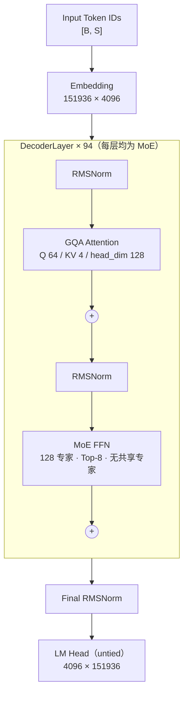

# Qwen3-235B-A22B

`Qwen3 系列 · MoE · GQA · 235B 总参数 / 22B 激活 · 2025-04 发布`

Qwen3 旗舰 MoE：与 [Qwen3-30B-A3B](/qwen/qwen3-30b-a3b/) 完全同构，仅规模不同——94 层、hidden 4096、64 Q head、专家中间维 1536。本页重点列规格与两者对比，GQA / MoE 的机制细节见 30B-A3B 页。

## 规格总览

以下数值取自 [HF config.json](https://huggingface.co/Qwen/Qwen3-235B-A22B/raw/main/config.json)（本地快照 `data/models/raw/qwen3-235b-a22b.json`）。

| 项 | 值 |
| --- | --- |
| 模型类 | `Qwen3MoeForCausalLM`（`model_type: qwen3_moe`） |
| 总参数 / 激活参数 | 235B / 22B（官方模型卡） |
| 层数 | 94 |
| Hidden Size | 4096 |
| Attention | GQA：Q Heads 64，KV Heads 4，Head Dim 128 |
| RoPE | `theta = 1e6`，全维旋转，无 rope_scaling；原生 40960，YaRN 外推至 131072（模型卡） |
| FFN | MoE：128 专家，Top-8，`moe_intermediate_size = 1536`，无共享专家 |
| Router | softmax 打分 + Top-8 + `norm_topk_prob` |
| 词表 / LM Head | vocab 151936，`tie_word_embeddings = false` |
| Norm | RMSNorm，eps 1e-6，Pre-Norm |
| 权重精度 / 体积 | 主仓 BF16 · **470.2 GB**；官方 FP8 版 239.0 GB（[Qwen3-235B-A22B-FP8](https://huggingface.co/Qwen/Qwen3-235B-A22B-FP8)）。体积为仓库 safetensors 实测总和（`data/models/weight_sizes.json`，下同） |
| KV Cache 精度 | 默认 **BF16**（188 KiB/token，见下）；官方未发布量化 KV 配置，FP8 KV 属框架侧通用能力 |

## 整体结构

## Attention 与 MoE

结构与 Qwen3-30B-A3B 相同，仅投影维度变化：`q_proj 4096×8192`、`k_proj / v_proj 4096×512`、`o_proj 8192×4096`；专家 SwiGLU 为 `4096 → 1536 → 4096`。

- **KV Cache（BF16）**：每 token `2 × 94 × 4 × 128 × 2B = 188 KiB`——KV head 依然只有 4 个，长上下文 KV 增长与 30B 模型同数量级。
- **激活参数估算**：Attention ≈ 6.7B，MoE ≈ 14.2B，Embedding + Head ≈ 1.24B，合计 ≈ **22B**。

## 与 Qwen3-30B-A3B 对比

| 项 | Qwen3-30B-A3B | Qwen3-235B-A22B |
| --- | --- | --- |
| 层数 / hidden | 48 / 2048 | 94 / 4096 |
| Q / KV Heads | 32 / 4 | 64 / 4 |
| 每层激活 MoE 参数 | 8 × 3 × 2048×768 ≈ 37.7M | 8 × 3 × 4096×1536 ≈ 151M |
| 总参数 / 激活 | 30.5B / 3.3B | 235B / 22B |
| 其余（RoPE、Router、vocab、结构） | 相同 | 相同 |

## 原始资料

- [Hugging Face 模型仓库](https://huggingface.co/Qwen/Qwen3-235B-A22B)（config.json / 模型卡）
- [Qwen3 博客](https://qwenlm.github.io/blog/qwen3/)
- 本地 config 快照：`data/models/raw/qwen3-235b-a22b.json`
