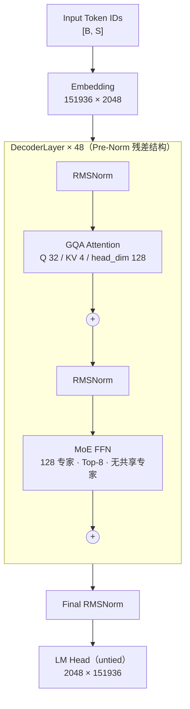
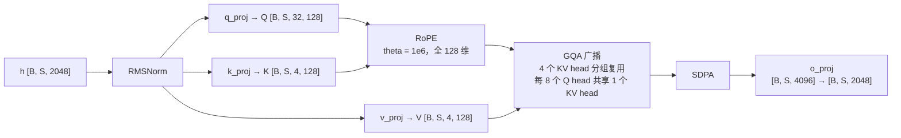
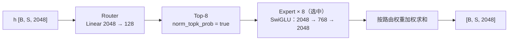

# Qwen3-30B-A3B

`Qwen3 系列 · MoE · GQA · 30.5B 总参数 / 3.3B 激活 · 2025-04 发布`

Qwen3 MoE 家族的中小型旗舰：48 层 Decoder、每层 GQA + 细粒度 MoE（128 选 8、无共享专家），以约 3.3B 激活参数达到上代 Qwen2.5-32B（Dense）的水平。支持 thinking / non-thinking 双模式。

## 规格总览

以下数值除注明外均取自 [HF config.json](https://huggingface.co/Qwen/Qwen3-30B-A3B/raw/main/config.json)（本地快照 `data/models/raw/qwen3-30b-a3b.json`）。

| 项 | 值 |
| --- | --- |
| 模型类 | `Qwen3MoeForCausalLM`（`model_type: qwen3_moe`） |
| 总参数 / 激活参数 | 30.5B / 3.3B（官方模型卡） |
| 层数 | 48 |
| Hidden Size | 2048 |
| Attention | GQA：Q Heads 32，KV Heads 4，Head Dim 128 |
| RoPE | `theta = 1e6`，全维旋转，无 rope_scaling；原生 40960，YaRN 外推至 131072（模型卡） |
| QKV Bias | 无（`attention_bias: false`，Qwen2 有，Qwen3 移除） |
| FFN | MoE：128 专家，Top-8，`moe_intermediate_size = 768`，无共享专家 |
| Router | softmax 打分 + Top-8 + `norm_topk_prob`（权重归一化） |
| 词表 / LM Head | vocab 151936，`tie_word_embeddings = false` |
| Norm | RMSNorm，eps 1e-6，Pre-Norm |
| 权重精度 / 体积 | 主仓 BF16 · **61.1 GB**；官方 FP8 版 32.4 GB（[Qwen3-30B-A3B-FP8](https://huggingface.co/Qwen/Qwen3-30B-A3B-FP8)）。体积为仓库 safetensors 实测总和（`data/models/weight_sizes.json`，下同） |
| KV Cache 精度 | 默认 **BF16**（96 KiB/token，见 Attention 节）；官方未发布量化 KV 配置，FP8 KV 属框架侧通用能力（vLLM `--kv-cache-dtype` / SGLang） |

## 整体结构

`decoder_sparse_step = 1`：**每一层都是 MoE 层**（没有 Dense 前置层）。config 中的 `intermediate_size = 6144` 与 `mlp_only_layers = []` 为保留字段，本模型未启用 Dense MLP 路径。

## Attention：GQA

要点：

- **投影形状**：`q_proj 2048×4096`，`k_proj / v_proj 2048×512`，`o_proj 4096×2048`，均无 bias。
- **KV Cache（BF16）**：每 token 为 `2 × 48 层 × 4 KV head × 128 维 × 2B = 96 KiB`；100 万 token 约 96 GB——GQA 把 KV 头压到 4 个是长上下文部署的关键。
- 与 Qwen2 相比**移除了 QKV bias**，只剩 q/k 归一化路径上的 RoPE。

## MoE：细粒度专家

要点：

- **无共享专家**：与 DeepSeek-V3 / GLM-4.5 / Kimi-K2 不同，Qwen3 MoE 每层只有 128 个路由专家，激活 8 个。
- 路由为 softmax 打分后 Top-8，再对 8 个权重归一化（`norm_topk_prob`）；`router_aux_loss_coef = 0.001` 仅保留极小的辅助负载均衡损失。
- **激活参数构成估算**（权重仅计矩阵参数）：
  - Attention：`48 × (4096×2048×2 + 512×2048×2) ≈ 0.90B`
  - MoE：`48 × 8 × 3 × 2048×768 ≈ 1.81B`
  - Embedding + LM Head（untied）：`2 × 151936×2048 ≈ 0.62B`
  - 合计 ≈ **3.3B**，与官方激活参数一致。

## 演进

| 对比对象 | 主要差异 |
| --- | --- |
| Qwen2.5-32B（Dense） | Dense MLP（intermediate 10240）→ MoE 128 选 8；MLA 级别的 KV 压缩没有采用，靠 GQA（4 KV head）控制 KV Cache |
| Qwen3-235B-A22B | 同代旗舰，结构同构：层数 48→94、hidden 2048→4096、Q heads 32→64、moe_intermediate 768→1536 |
| Qwen3-Next（2025-09） | 后续方向：Gated DeltaNet（线性注意力）与 Full Attention **混合层**，并引入 MTP；详见各代页面 |

## 原始资料

- [Hugging Face 模型仓库](https://huggingface.co/Qwen/Qwen3-30B-A3B)（config.json / 模型卡）
- [Qwen3 博客](https://qwenlm.github.io/blog/qwen3/)
- 本地 config 快照：`data/models/raw/qwen3-30b-a3b.json`
