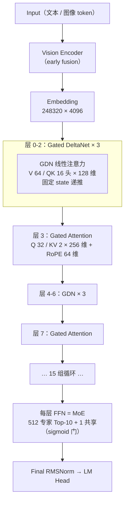
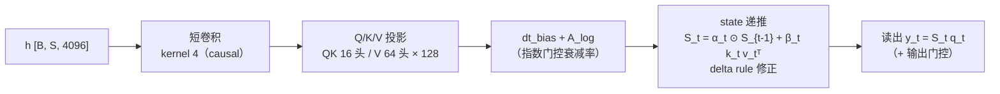
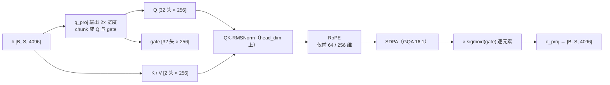
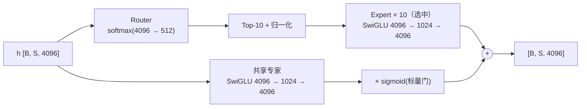

# Qwen3.5 系列

`Qwen3.5 系列 · 混合线性注意力（GDN + Gated Attention）· MoE / Dense · 全系原生多模态 · 2026-02 发布`

Qwen3.5 把 Qwen3-Next 验证过的混合架构铺满全家族：**每 4 层中 3 层 Gated DeltaNet（线性注意力）+ 1 层 Gated Attention（全注意力）**，全系原生 262,144 上下文、early-fusion 多模态（Vision Encoder 内建）。旗舰 [Qwen3.5-397B-A17B](https://huggingface.co/Qwen/Qwen3.5-397B-A17B) 是 17B 激活的 MoE，Apache-2.0 开源。

## 规格总览（全家族）

发布于 2026-02-25 ~ 02-28。数值取自各模型 [config.json](https://huggingface.co/Qwen/Qwen3.5-397B-A17B/raw/main/config.json)（本地快照 `data/models/raw/qwen3.5-*.json`）与官方模型卡。

| 模型 | 总参 / 激活 | 层数 | Hidden | GDN V/QK 头 | Full 层 Q / KV 头 | FFN | 发布 |
| --- | --- | --- | --- | --- | --- | --- | --- |
| Qwen3.5-0.8B / 2B / 4B / 9B | Dense 小尺寸 | — | — | 同构 | 同构 | Dense | 02-27~28 |
| Qwen3.5-27B | 27B Dense | 64 | 5120 | 48 / 16 | 24 / 4 | inter 17408 | 02-27 |
| Qwen3.5-35B-A3B | 35B / 3B | 40 | 2048 | 32 / 16 | 16 / 2 | 256 专家 Top-8 + 1 共享 | 02-25 |
| Qwen3.5-122B-A10B | 122B / 10B | 48 | 3072 | 64 / 16 | 32 / 2 | 256 专家 Top-8 + 1 共享 | 02-25 |
| **Qwen3.5-397B-A17B** | **397B / 17B** | **60** | **4096** | **64 / 16** | **32 / 2** | **512 专家 Top-10 + 1 共享** | 02-25 |

全系共同点（397B 为例）：

| 项 | 值 |
| --- | --- |
| 模型类 | `Qwen3_5MoeForConditionalGeneration`（`model_type: qwen3_5_moe`；Dense 版为 `qwen3_5`） |
| 层排布 | `layer_types`: 60 层 = **15 × (3 × linear_attention + 1 × full_attention)**，full 层位于第 3, 7, 11, … 层 |
| 线性层 | Gated DeltaNet：V 头 64 / QK 头 16，head_dim 128（key/value 同维），conv kernel 4 |
| 全注意力层 | Gated Attention：Q 32 / KV 2，head_dim **256**，RoPE 仅前 64 维（partial 0.25），QK-RMSNorm |
| MoE | 512 专家 Top-10 + 1 共享专家（`shared_expert_intermediate_size = 1024`，与专家同宽），`moe_intermediate_size = 1024` |
| Router | **softmax 打分 + Top-k + 权重归一化**（transformers `Qwen3_5MoeTopKRouter` 源码核实，Qwen 学派；无 bias 项） |
| 共享专家门控 | `sigmoid(shared_expert_gate(h))` 逐 token 标量门（Qwen3-Next 同款） |
| 上下文 | 原生 262,144，模型卡口径可外推至 ≈1M（YaRN） |
| 词表 | 248,320（padded），LM Head untied |
| MTP | 训练期多步 MTP（checkpoint 含 `mtp.*` 权重，推理侧可选启用） |
| 多模态 | Vision Encoder + early fusion，`image-text-to-text` 管线 |
| 权重精度 / 体积 | 主仓 BF16：397B **806.8** / 122B 250.2 / 35B 71.9 / 27B 55.6 GB；官方 FP8 版 406.2 / 127.2 / 37.5 / 30.9 GB（[397B-FP8](https://huggingface.co/Qwen/Qwen3.5-397B-A17B-FP8)，各尺寸同 `-FP8` 后缀），另有 GPTQ-Int4 版 235.7 / 78.9 / 24.4 / 30.2 GB。体积为仓库 safetensors 实测总和（`data/models/weight_sizes.json`，下同） |
| KV Cache 精度 | 默认 **BF16**（full 层 KV 30 KiB/token + GDN 固定 state 90 MiB，397B 口径见 Attention 节）；官方无量化 KV / state 配置，FP8 KV 属框架侧通用能力 |
| License | Apache-2.0 |

## 整体结构（以 397B-A17B 为例）

关键点：**注意力与 FFN 是每层独立配置的**——上图把层排布与 FFN 拆开画，实际每个层都是「Token Mixer（GDN 或 GA）→ MoE」。

## Attention：3:1 混合

### GDN 线性层（75% 的层）

- state 形状 `[64, 128, 128]`，**与序列长度无关**；transformers 实现 `Qwen3_5GatedDeltaNet` 直接继承 `Qwen3NextGatedDeltaNet`（源码核实）。
- 递推中的 `α_t`（遗忘门）与 `β_t`（写入强度）由输入经 sigmoid 生成（`A_log` 初始化 0.01~16 取对数，源码核实）。

### Gated Attention 全注意力层（25% 的层）

与 Qwen3 的 GQA 相比三处变化：**head_dim 128→256 且 RoPE 只转 64 维**（partial rotary，长外推更稳）；**Q/K 增加 head_dim 级 RMSNorm**；**输出乘 sigmoid 门**（`q_proj` 输出翻倍 chunk 出 gate，transformers `Qwen3_5Attention` 源码核实）。

### KV Cache / State 核算（推理向，BF16）

| 模型 | Full 层 KV | 每 token KV 增量 | GDN 固定 state | @1M token 显存 |
| --- | --- | --- | --- | --- |
| 397B-A17B | 15 层 × 2 头 × 256 | **30 KiB/token** | 2 MiB × 45 层 = 90 MiB | ≈30 GiB + 90 MiB |
| 122B-A10B | 12 层 | 24 KiB/token | 72 MiB | ≈24 GiB |
| 35B-A3B | 10 层 | 20 KiB/token | 30 MiB | ≈20 GiB |
| 27B Dense | 16 层 × 4 头 | 64 KiB/token | 72 MiB | ≈64 GiB |

公式：每 token KV = `2 × H_kv × 256 × 2B × full层数`；GDN state = `V头 × 128 × 128 × 2B × 线性层数`（序列无关）。对比 [Qwen3-235B-A22B](/qwen/qwen3-235b-a22b/)（全 GQA，188 KiB/token）：同为 1M 上下文，397B 的 KV 显存约为其 **1/6**——这是混合架构对推理侧的最大红利。注意 GDN state 是**每序列**固定开销，小 batch 短序列时它反而占主导。

## MoE：细粒度 + 门控共享专家

- 路由是 **softmax + Top-k + 归一化**（`router_top_value /= sum`，源码核实），延续 Qwen3 学派；与 DeepSeek 系（sigmoid + e_score_correction_bias + noaux_tc）形成对照，详见 [MoE 总览](/guide/moe/)。
- 共享专家输出经**逐 token 标量 sigmoid 门**再相加（`shared_expert_gate: Linear(4096→1)`）。
- 激活构成主项（397B，估算）：路由专家 `60 × 10 × 3 × 4096×1024 ≈ 7.6B` + 共享 ≈0.76B + 注意力（两类层合计）≈3B + Embedding/Head ≈2B，量级与官方 17B 一致（官方口径含全部激活模块）。

## 演进

| 对比对象 | 主要差异 |
| --- | --- |
| Qwen3（2025-04） | 全层 GQA → 3:1 混合（GDN 为主）；KV head_dim 128→256（仅 full 层）；vocab 151936→248320；纯文本 → 原生多模态；每层 MoE 不变但增加门控共享专家 |
| Qwen3-Next-80B-A3B（2025-09） | 试验田转正：Qwen3.5 全系继承其 GDN 实现（`Qwen3NextGatedDeltaNet`）；3:1 比例与「full 层位于 idx ≡ 3 (mod 4)」的排布一致 |
| [Qwen3.6](/qwen/qwen3.6/) | 架构逐字段相同，训练迭代（agentic coding 强化、thinking 保留） |
| [Qwen3.8](/qwen/qwen3.8/) | 同架构放大到 2.4T-A95B（Max 级开源）+ 27B Dense 刷新 |

## 原始资料

- [Qwen3.5-397B-A17B 模型卡](https://huggingface.co/Qwen/Qwen3.5-397B-A17B)（Model Overview / Highlights）
- [Qwen3.5 博客](https://qwen.ai/blog?id=qwen3.5)
- transformers 源码：`models/qwen3_5/modeling_qwen3_5.py`、`models/qwen3_5_moe/modeling_qwen3_5_moe.py`（layer_types 分派 / Gated Attention / Router）
- 本地 config 快照：`data/models/raw/qwen3.5-397b-a17b.json` 等 4 份
