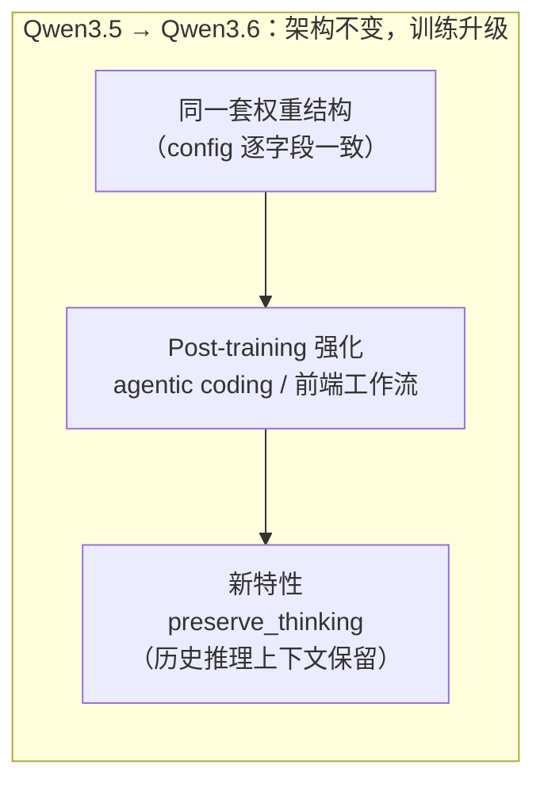

# Qwen3.6

`Qwen3.6 系列 · 混合线性注意力（GDN + Gated Attention）· MoE / Dense · 2026-04 发布`

Qwen3.6 是 [Qwen3.5](/qwen/qwen3.5/) 的**训练迭代代**：两个开源尺寸（35B-A3B、27B）的 config 与 Qwen3.5 对应尺寸逐字段相同，架构零变化，升级集中在 post-training——官方 Highlights 为 **Agentic Coding**（前端工作流与仓库级推理）与 **Thinking Preservation**（跨轮对话保留历史推理上下文的 `preserve_thinking` 选项）。

## 规格总览

取自 [config.json](https://huggingface.co/Qwen/Qwen3.5-397B-A17B/raw/main/config.json) 同源的 [Qwen3.6-35B-A3B config](https://huggingface.co/Qwen/Qwen3.6-35B-A3B/raw/main/config.json)（本地快照 `data/models/raw/qwen3.6-*.json`）。

| 项 | Qwen3.6-35B-A3B（2026-04-15） | Qwen3.6-27B（2026-04-21） |
| --- | --- | --- |
| 模型类 | `Qwen3_5MoeForConditionalGeneration`（`model_type` 仍是 `qwen3_5_moe`） | `Qwen3_5ForConditionalGeneration`（`qwen3_5`） |
| 总参 / 激活 | 35B / 3B | 27B Dense |
| 层数 | 40（10 × (3 GDN + 1 Gated Attention)，full 层 idx ≡ 3 mod 4） | 64（16 × 同排布） |
| Hidden | 2048 | 5120 |
| GDN | V 32 / QK 16 头 × 128，conv kernel 4 | V 48 / QK 16 头 × 128 |
| Gated Attention | Q 16 / KV 2 × 256，RoPE 64 维 | Q 24 / KV 4 × 256，RoPE 64 维 |
| FFN | 256 专家 Top-8 + 1 共享（sigmoid 门），inter 512 | Dense inter 17408 |
| Router | softmax + Top-k + 归一化 | — |
| 上下文 | 262,144 原生，≈1M 外推（模型卡） | 同 |
| KV / State（BF16） | 20 KiB/token + 30 MiB 固定 state | 64 KiB/token + 72 MiB 固定 state |
| 权重精度 / 体积 | 主仓 BF16 · **71.9 GB**；[FP8 版](https://huggingface.co/Qwen/Qwen3.6-35B-A3B-FP8) 37.5 GB | 主仓 BF16 · **55.6 GB**；[FP8 版](https://huggingface.co/Qwen/Qwen3.6-27B-FP8) 30.9 GB |
| License | Apache-2.0 | Apache-2.0 |

与 Qwen3.5 同尺寸逐字段 diff 为空（本地快照核对）；模型卡 Model Overview 的 Hidden Layout、GDN/GA/MoE 条目也完全一致。权重体积为各仓库 safetensors 实测总和（`data/models/weight_sizes.json`）；KV 默认 BF16，官方无量化 KV 配置。

## 架构

**与 Qwen3.5 完全同构**，层排布、Gated Attention 门控、MoE 路由（softmax 学派 + 门控共享专家）、KV/state 核算公式全部见 [Qwen3.5 页](/qwen/qwen3.5/)。

## 演进

| 对比对象 | 主要差异 |
| --- | --- |
| [Qwen3.5](/qwen/qwen3.5/) | 架构相同；3.6 官方主打 agentic coding 与 thinking 保留，尺寸仅开源 35B-A3B + 27B（无旗舰刷新） |
| [Qwen3.8](/qwen/qwen3.8/) | 3.8 = 同架构的旗舰放大（2.4T-A95B）+ 27B 再刷新；中间存在仅 API 的 Qwen3.7-Max/Plus（未开源） |

## 原始资料

- [Qwen3.6-35B-A3B 模型卡](https://huggingface.co/Qwen/Qwen3.6-35B-A3B)（Highlights / Model Overview）
- 本地 config 快照：`data/models/raw/qwen3.6-35b-a3b.json`、`data/models/raw/qwen3.6-27b.json`
