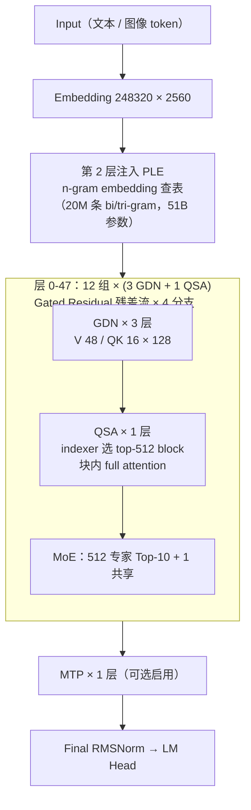
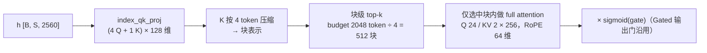

# Qwen3.8-Flash-Next

`Qwen4 架构实验预览 · GDN + Qwen Sparse Attention · Gated Residual × 4 分支 · n-gram Embedding · 125B 总参 / 6B 激活 · 2026-08-24 发布`

官方定位：「the architecture that will underpin **Qwen4**」的实验预览。在 3:1 混合骨架上做了三处结构性替换/新增——全注意力层换成 **Qwen Sparse Attention（QSA，块级稀疏）**、残差改成 **Gated Residual（4 分支宽残差 + 数据依赖门控）**、第 2 层注入 **51B 参数的 n-gram embedding 查表**。License 为 qwen-community-1.0（非 Apache）。

## 规格总览

取自 [config.json](https://huggingface.co/Qwen/Qwen3.8-Flash-Next/raw/main/config.json)（本地快照 `data/models/raw/qwen3.8-flash-next.json`）与模型卡。

| 项 | 值 |
| --- | --- |
| 模型类 | `Qwen4ExpForConditionalGeneration`（`model_type: qwen4_exp`） |
| 总参 / 激活 | 125B / 6B + **51B n-gram embedding** + 4B MTP（模型卡口径分列） |
| 层数 | 48 = **12 × (3 × GDN + 1 × QSA)**，稀疏层 idx ≡ 3 (mod 4) |
| Hidden | 2560 |
| GDN | V 48 / QK 16 头 × 128，conv kernel 4（与 Qwen3.5 同款） |
| QSA | Q 24 / KV 2，head_dim 256，RoPE 64 维；indexer：**MQA 4 Q 头 / 1 共享 K 头 × 128 维**，`indexer_budget = 2048` token，`indexer_compress_ratio = 4` → **top-512 block** |
| MoE | 512 专家 Top-10 + 1 共享（inter 640），softmax + 归一化路由（Qwen 学派） |
| Gated Residual | `hc_count = 4` 分支（宽残差 4×hidden），`hc_lowrank = 320` 瓶颈；elementwise 读门 + 每分支标量写门 |
| n-gram Embedding | 20,000,000 条 bi/tri-gram（`ngram_size = 3`），splitmix64 哈希索引，PLE 注入第 2 层 |
| 上下文 | 262,144 原生，≈1M 外推（模型卡） |
| MTP | 1 层，多步训练 |
| 多模态 | 原生（Vision Encoder，API 侧 Qwen3.8-Flash 默认 1M 上下文） |
| 权重精度 / 体积 | 主仓 BF16 · **360.0 GB**（含 51B n-gram 嵌入表）；FP8 版 185.5 GB（[Qwen3.8-Flash-Next-FP8](https://huggingface.co/Qwen/Qwen3.8-Flash-Next-FP8)）。体积为仓库 safetensors 实测总和（`data/models/weight_sizes.json`，下同） |
| KV Cache 精度 | 默认 **BF16**（稀疏层 KV 24 KiB/token + indexer K ≈3 KiB/token + GDN state 54 MiB/序列，见 Attention 节）；官方无量化 KV 配置 |
| License | qwen-community-1.0 |

## 整体结构

## Attention：QSA（Qwen Sparse Attention）

与 DeepSeek-V3.2 / Hy4 的 DSA「按 token 选 top-k」不同，QSA 在**micro-block 级**做选择（`indexer_compress_ratio = 4`：key 先按 4 token 压缩成块表示，再选块）：

- indexer 是 **MQA**（4 个 query 头共享 1 个 key 头，head_dim 128），带 Q/K RMSNorm（transformers `Qwen4ExpTextQSAIndexer` 源码核实）。
- 官方 Highlights：块级选择显著降低长上下文延迟（agentic 负载主导场景）。
- KV 核算（BF16）：稀疏层 12 × `2 × 2 × 256 × 2B` = **24 KiB/token** + indexer K 缓存（1 头 × 128 × 2B × 12 层 ≈ 3 KiB/token）；GDN state 36 层 × 1.5 MiB = **54 MiB/序列**。

## Gated Residual（宽残差 + 门控）

把单条残差流拓宽为 `hc_count = 4` 条（hidden 拼接后 4×2560），层间信息流经两级门控（transformers `Qwen4ExpTextGatedResidual` 源码核实）：

- **读门（elementwise）**：`sigmoid(up(silu(down(hc_norm(S)))))` 低秩瓶颈 320，逐元素调制后对各分支取均值作为本层输入；
- **写门（每分支标量）**：`2 × sigmoid(Linear(S → 4))`，控制本层输出写回 4 条残差流的强度。

与 Hunyuan Hy4 的 iHC（identity Hyper-Connections，同为 4 残差流）是同一设计空间的不同实例化——Hy4 走恒等映射 + 可学习静态混合，Qwen 走数据依赖门控。官方称其在保持训练稳定的同时把推理开销压得很低。

## n-gram Embedding（51B 参数的查表扩展）

参数扩展的新轴向：不增加每 token 计算量、比 MoE 更适合 offload。20M 个 bi/tri-gram 经 **splitmix64 哈希**映射到 embedding 行，在**第 2 层**通过 PLE（Progressive Layer Embedding）注入。51B 查表参数使总盘面达 125B+51B+4B，而激活仍为 6B——显存受限加速器上可把 embedding 表单独 offload。

## 训练配方（官方口径）

Muon 与 AdamW 按权重类别分别使用；基于重拟合 scaling law 取消传统 batch size warmup，直接以目标 batch size 起训，减少总 optimizer step 数并支持更大学习率。

## 演进

| 对比对象 | 主要差异 |
| --- | --- |
| [Qwen3.5 / 3.8](/qwen/qwen3.5/) | Gated Attention（全注意力）→ **QSA**（块稀疏，budget 2048 token）；单残差流 → **Gated Residual 4 分支**；新增 n-gram embedding 与 Muon 配方 |
| DeepSeek-V3.2 / Hunyuan Hy4 的 DSA | 同为「indexer + 稀疏预算」路线；QSA 以**块**（4 token）为选择单位，DSA 按 token 选 top-2048 |
| Hunyuan Hy4 的 iHC | 同为 4 残差流宽残差；iHC 为静态可学习混合，Gated Residual 为数据依赖门控 |

## 原始资料

- [Qwen3.8-Flash-Next 模型卡](https://huggingface.co/Qwen/Qwen3.8-Flash-Next)（Highlights / Model Overview）
- [技术报告](https://github.com/QwenLM/Qwen3.8-Flash-Next/blob/main/tech_report.pdf)
- transformers 源码：`models/qwen4_exp/modeling_qwen4_exp.py`（QSAIndexer / GatedResidual / NGramEmbedding）
- 本地 config 快照：`data/models/raw/qwen3.8-flash-next.json`
