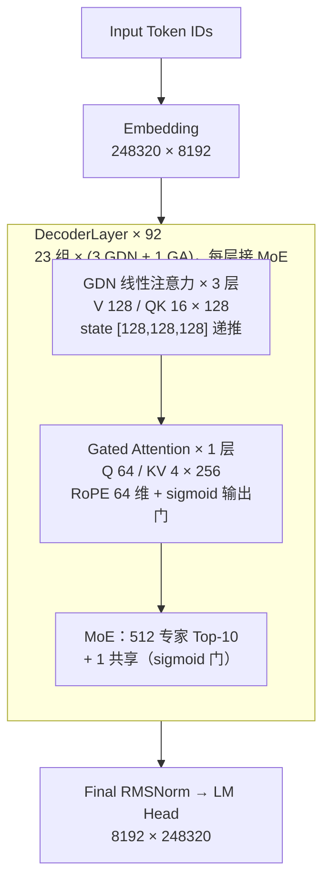

# Qwen3.8

`Qwen3.8 系列 · 混合线性注意力（GDN + Gated Attention）· 2.4T-A95B 旗舰 + 27B Dense · 2026-08 发布`

Qwen3.8 是 Qwen 开源家族首次放出 **Max 级旗舰**：[Qwen3.8-2.4T-A95B](https://huggingface.co/Qwen/Qwen3.8-2.4T-A95B)（2.4 万亿总参 / 95B 激活，即 API 侧 Qwen3.8-Max 的开源基座），架构延续 Qwen3.5 的 3:1 混合（GDN + Gated Attention），官方口径「Built on the architectural foundation of Qwen3.5」。同代开源 [Qwen3.8-27B](https://huggingface.co/Qwen/Qwen3.8-27B)（Dense，与 3.6-27B 架构相同）。注意 2.4T 旗舰 license 为 **qwen3.8-max**（非 Apache），27B 为 Apache-2.0。

## 规格总览

数值取自 [config.json](https://huggingface.co/Qwen/Qwen3.8-2.4T-A95B/raw/main/config.json)（本地快照 `data/models/raw/qwen3.8-2.4t-a95b.json`、`qwen3.8-27b.json`）与模型卡。

### Qwen3.8-2.4T-A95B（2026-08-08，另有 FP8 版）

| 项 | 值 |
| --- | --- |
| 模型类 | `Qwen3_5MoeForCausalLM`（`model_type: qwen3_5_moe_text`，**纯文本**，无 Vision 分支） |
| 总参 / 激活 | 2.4T / 95B（模型卡） |
| 层数 | 92 = **23 × (3 × GDN + 1 × Gated Attention)**，full 层 idx ≡ 3 (mod 4) |
| Hidden | 8192 |
| GDN | V 128 / QK 16 头，head_dim 128，conv kernel 4 |
| Gated Attention | Q 64 / KV 4，head_dim 256，RoPE 前 64 维（`partial_rotary_factor = 0.25`），QK-RMSNorm，sigmoid 输出门 |
| MoE | 512 专家 Top-10 + 1 共享（inter 2048），`moe_intermediate_size = 2048` |
| Router | softmax + Top-10 + 归一化（同 Qwen3.5） |
| 上下文 | 262,144 原生；Qwen3.8-Max API 默认 1M |
| 词表 | 248,320（padded） |
| MTP | 多步训练（模型卡） |
| 权重精度 / 体积 | 主仓 BF16 · **4892.4 GB**；官方 FP8 版 2496.1 GB（[Qwen3.8-2.4T-A95B-FP8](https://huggingface.co/Qwen/Qwen3.8-2.4T-A95B-FP8)）。体积为仓库 safetensors 实测总和（`data/models/weight_sizes.json`，下同） |
| KV Cache 精度 | 默认 **BF16**（full 层 92 KiB/token + GDN state 276 MiB/序列固定开销，见 Attention 节）；官方无量化 KV 配置，FP8 KV 属框架侧通用能力 |
| License | qwen3.8-max（`license: other`） |

### Qwen3.8-27B（2026-08-05）

64 层 Dense（16 × 混合组），hidden 5120，与 Qwen3.6-27B 的 config 逐字段一致（本地快照核对）——纯训练刷新。原生多模态（ForConditionalGeneration），Apache-2.0。权重 BF16 **55.6 GB** / [FP8](https://huggingface.co/Qwen/Qwen3.8-27B-FP8) 30.9 GB（safetensors 实测，`data/models/weight_sizes.json`）。

## 整体结构（2.4T-A95B）

注意力与 MoE 的机制细节（GDN 递推、Gated Attention 门控、softmax 路由 + 门控共享专家）与 [Qwen3.5](/qwen/qwen3.5/) 完全一致，此处不重复。

## KV Cache / State 核算（2.4T，推理向）

- Full 层（23 层）：`2 × 4 KV头 × 256 × 2B × 23 = 92 KiB/token`——**比 397B 的 30 KiB/token 高 3 倍**（KV head 2→4、full 层 15→23），但仍远低于全 GQA 模型（[Qwen3-235B](/qwen/qwen3-235b-a22b/) 为 188 KiB/token）。1M token ≈ 92 GiB/序列。
- GDN state（69 层）：`128 × 128 × 128 × 2B = 4 MiB/层`，合计 **276 MiB/序列固定开销**。
- 部署：官方 FP8 仓库 [Qwen3.8-2.4T-A95B-FP8](https://huggingface.co/Qwen/Qwen3.8-2.4T-A95B-FP8)；BF16 权重约 4.8 TB，需多机 TP/EP（H20/B200 级集群口径，具体卡数待核实）。

## 演进

| 对比对象 | 主要差异 |
| --- | --- |
| [Qwen3.5-397B-A17B](/qwen/qwen3.5/) | 同构放大：层数 60→92、hidden 4096→8192、GDN V 头 64→128、KV head 2→4、专家 inter 1024→2048；激活 17B→95B（5.6×） |
| Qwen3.7-Max / Plus（2026，未开源） | 3.6 与 3.8 之间的 API-only 代际（仅出现在官方 benchmark 对照列，HF 无权重仓库） |
| [Qwen3.8-Flash-Next](/qwen/qwen3.8-flash-next/) | 同期发布的 **Qwen4 架构实验预览**：Gated Attention → Qwen Sparse Attention（块稀疏），另加 Gated Residual 与 n-gram embedding |

## 原始资料

- [Qwen3.8-2.4T-A95B 模型卡](https://huggingface.co/Qwen/Qwen3.8-2.4T-A95B)（Model Overview / Highlights）
- [Qwen3.8-27B 模型卡](https://huggingface.co/Qwen/Qwen3.8-27B)
- [Qwen3.8-Max 博客](https://qwen.ai/blog?id=qwen3.8)
- 本地 config 快照：`data/models/raw/qwen3.8-2.4t-a95b.json`、`data/models/raw/qwen3.8-27b.json`
